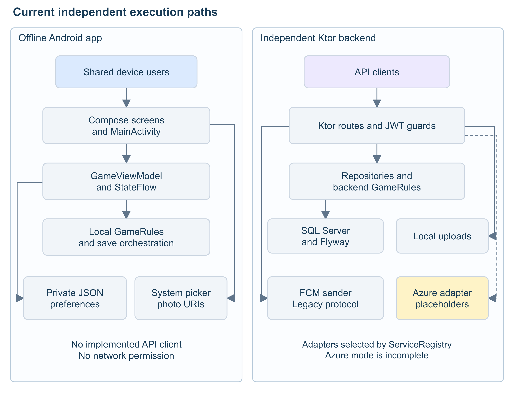

# Choreemon software design document

Reviewed 19 October 2026 | Audience Engineering and technical reviewers

## System overview

Choreemon turns household chores into quests. Members earn points, hatch creatures, and develop their active companion through experience points. Adults manage quests and review submissions. The implemented Android experience runs entirely on one shared device. A separate Kotlin backend implements an API and SQL persistence, but the Android project has no API client, network permission, or authentication integration. These are two independent execution paths today. [A1](source-index.md#a1), [A2](source-index.md#a2), [A5](source-index.md#a5), [A8](source-index.md#a8), [B1](source-index.md#b1)

The main engineering decision is to preserve the offline app as a working product while treating backend integration as unfinished work. Azure authentication and storage are placeholders, and backend authorization and transaction handling need remediation before exposure to untrusted clients. The accompanying threat model gives the security findings and acceptance criteria.

## Scope and implementation status

| Area | Observed implementation |
| --- | --- |
| Android product | Compose screens, local profiles, quests, approvals, creature collection, egg hatching, rankings, settings and local photos |
| Android persistence | One version 1 JSON aggregate in private SharedPreferences |
| Backend | Ktor REST routes, repositories, SQL Server schema and Flyway migrations |
| Local authentication | Email and BCrypt password login with HMAC signed JWTs; invite code enrollment |
| Azure mode | Selects an unsigned JWT verifier and a storage adapter that returns URLs without uploading bytes |
| Notifications | Backend attempts legacy FCM sends or logs messages when its server key is absent; Android has no FCM integration |
| Proposed infrastructure | Parent web portal, Room cache, MSAL integration, managed secrets and Azure deployment are described in older documents but have no corresponding implementation here |

The two existing root documents remain historical design inputs. Their ASP.NET or Node backend and complete Azure platform diagram do not describe the current Kotlin implementation. Source code and migrations take precedence in this document. [B1](source-index.md#b1), [B2](source-index.md#b2), [B20](source-index.md#b20), [B22](source-index.md#b22), [B23](source-index.md#b23)

## Architecture

The left path is the shipped Android design. Compose reads a StateFlow owned by GameViewModel. User actions invoke pure GameRules functions or direct state transformations, persist the new aggregate, and publish it to the UI. The right path is the independent backend. Requests pass through Ktor plugins and authentication to routes, repositories, and SQL Server. ServiceRegistry chooses authentication and storage adapters using ENV. There is no implemented connection between the two paths. [A1](source-index.md#a1), [A2](source-index.md#a2), [B1](source-index.md#b1), [B2](source-index.md#b2)

| Component | Responsibility | Evidence |
| --- | --- | --- |
| MainActivity and ui package | Manual route state, tabs, dialogs, animation, lifecycle refresh and parent session gate | A1 |
| GameViewModel | StateFlow state, local actions, household creation and save orchestration | A2 |
| GameRules and model types | Quest eligibility, reward calculation, mood, streaks, evolution and milestone rules | A4, B24 |
| SaveCodec and GameRepository | Explicit JSON encoding, private preferences, recovery copies | A3 |
| Application | Plugin installation, JSON, CORS, errors, JWT validation and route registration | B1 |
| ServiceRegistry | Composition root for adapters and repositories | B2 |
| DatabaseFactory | Local database bootstrap, Flyway, Hikari connection pool and suspended transactions | B4 |
| Repository classes | Exposed SQL queries and per-operation transactions | B14 to B18 |
| Service interfaces | Authentication, file storage and notifications | B2, B19 to B23 |

Android targets SDK 36, supports SDK 26 and later, and compiles for Java 17. The root build declares Android Gradle Plugin 9.0.1 and Compose compiler plugin 2.2.10. Its app uses Compose BOM 2025.04.01. Backend build declarations pin Kotlin 2.2.20, Ktor 3.0.3, Exposed 0.55.0, Flyway 10.17.3, HikariCP 5.1.0 and SQL Server JDBC 12.8.1. These are source declarations, not a dependency vulnerability assessment. [A8](source-index.md#a8), [B25](source-index.md#b25)

## Android state and lifecycle

GameState holds the household name, display invite code, current profile and companion, members, creatures, chores, completions, week, PIN verifier, preferences and milestone keys. These are immutable data classes with copied lists. The local Member type has no role or online identity. Switching profiles selects another household member and their first companion without separate login. [A2](source-index.md#a2), [A4](source-index.md#a4)

At startup, GameRepository reads the state key from choreemon_household preferences. No saved state produces the demonstration household. A malformed or unsupported save is copied to a recovery key and the demo is returned. SaveCodec checks version 1, a valid active member, nonnegative member balances and at least one creature per member. It does not comprehensively validate all reference IDs, dates, enum ranges or active creature ownership. [A3](source-index.md#a3)

GameViewModel.update refreshes the current week, transforms state, calls SharedPreferences.apply and emits the new state. apply updates preferences asynchronously on disk; this is not a synchronous durability acknowledgement. The UI refreshes on resume and every 60 seconds while composed. Parent authorization is an in-memory flag cleared on ON_STOP. It gates management screens; the ViewModel itself is not a separate authorization boundary. [A1](source-index.md#a1), [A2](source-index.md#a2), [A3](source-index.md#a3)

The system picker supplies photo URIs. The app attempts to retain read permission and stores the URI rather than copying image bytes. Rendering tolerates inaccessible images with a placeholder. The app disables Android backup. Clearing app data or uninstalling removes progress, and revoking a URI grant or removing its source image may make proof unavailable. [A3](source-index.md#a3), [A5](source-index.md#a5), [A7](source-index.md#a7)

## Domain behavior

| Rule | Implemented behavior |
| --- | --- |
| Quest eligibility | Active member must be assigned; chore must be due and unarchived; no nonrejected completion may already occupy the relevant day or one-time quest |
| Schedules | DAILY, WEEKDAYS, WEEKENDS and ONCE; one-time eligibility depends on completion history |
| Rewards | Approved quest points increase wallet and weekly score; active creature gets rounded points multiplied by mood, with XP at least 1 |
| Mood | HAPPY at 0 to 1 days since adoption or latest approved chore; CONTENT at 2 to 3; SAD thereafter; daily love lifts one step |
| Progression | Level is XP divided by 40 plus 1; explicit evolution at 360 and 960 XP; three stages |
| Egg cost and odds | Classic 50 points with 60/35/5 percent common/rare/legendary; Enchanted 100 with 25/65/10; Aurora 200 with 10/60/30 |
| Family selection | Water, Earth, Air and Poison families are selected independently of rarity; duplicates allowed |
| Spending | Egg cost reduces wallet only; weekly ranking score is retained |
| Streak | Distinct consecutive approved submission dates; yesterday can anchor an unfinished current day |
| Milestone | Current floor of approved completion count divided by 10 yields a key; an unclaimed positive key grants 25 wallet points only |
| Weekly rollover | Android resets weekly points on Monday through refresh; backend reset helper methods exist but have no callers |

These rules are implemented in separately maintained Android and backend files. They are similar copies with differences in defaults, visibility and signatures, rather than a shared Gradle module. Milestone claims use the current count bucket; the implementation does not enumerate every previously missed reward bucket. Dates use LocalDate.now on each runtime without a household timezone setting. [A4](source-index.md#a4), [B24](source-index.md#b24), [B14](source-index.md#b14), [B15](source-index.md#b15)

## Core workflows

### Local quest completion and review

The quest screen requires its checklist to be checked before enabling submission. GameRules independently checks assignment, schedule and completion history, calculates a reward, and creates a completion snapshot containing title, points, XP, companion and optional photo URI. The checklist itself is UI state and is not persisted as evidence. A quest requiring approval becomes PENDING with no reward; otherwise it becomes APPROVED and grants points and XP in the same state transformation. [A4](source-index.md#a4), [A7](source-index.md#a7)

Parent review requires the completion to be PENDING. Approval changes status and grants its stored reward exactly once in sequential local state use. Rejection changes it to REJECTED so the member may retry. Delayed approval credits the currently refreshed week while preserving the original submission date used by the streak. This sequential guarantee does not establish concurrent backend safety. [A2](source-index.md#a2), [A4](source-index.md#a4)

### Local hatching and evolution

Hatching checks balance, rolls rarity and family, deducts wallet points and adds the creature before the reveal animation. The UI can then store a nickname. Evolution checks ownership and the next stage threshold. Local household setup creates one member, a free starter, four starter quests and a new salted PIN verifier. Demo mode seeds balances and history and uses its documented demonstration PIN. [A1](source-index.md#a1), [A2](source-index.md#a2), [A4](source-index.md#a4)

### Backend enrollment and authentication

Register creates a household, a parent with email and BCrypt password hash, a starter creature and a signed token in local mode. Login verifies credentials and returns a member, household and token. Public join accepts a reusable household code, creates a child member and starter and issues a child token. No parent approval, expiry or usage limit is attached to that code. Children created by join have no email or password, and no renewal or account recovery flow is implemented. Each repository write commits separately, so enrollment can leave partial records on failure. [B6](source-index.md#b6), [B14](source-index.md#b14), [B19](source-index.md#b19)

### Backend quest completion and review

Submission loads household lists, calls GameRules.complete, discards the returned state, builds another Completion, and writes it through the repository. Automatic rewards then update the member and creature in separate transactions. Review reads status, changes status, and applies the stored reward through separate calls. The pure rule checks are useful, but do not serialize concurrent requests or recover partial commits. Hatching similarly creates a creature before deducting its cost. [B10](source-index.md#b10), [B11](source-index.md#b11), [B15](source-index.md#b15), [B17](source-index.md#b17), [B18](source-index.md#b18)

### Backend notifications and files

Quest creation notifies assigned member tokens. Pending completion notifications are intended for parents, but the repository selects all household members other than the submitter; it does not filter is_parent. Network sends are awaited by the request, not queued durably. Missing FCM configuration logs titles and bodies. The configured sender uses the legacy /fcm/send endpoint, not HTTP v1. [B9](source-index.md#b9), [B10](source-index.md#b10), [B15](source-index.md#b15), [B23](source-index.md#b23)

Photo upload writes each multipart file through the selected adapter and returns the last URL. Local mode writes to uploads and serves through an authenticated API route. It has no photo metadata table or tenant owner binding. Azure mode returns a Blob-shaped URL without writing the stream, and its read method always returns null. MinIO is started by Compose but is not called by the selected local file adapter. [B2](source-index.md#b2), [B12](source-index.md#b12), [B21](source-index.md#b21), [B22](source-index.md#b22), [B27](source-index.md#b27)

## API inventory

All paths below are under /api unless shown otherwise. JWT refers to Ktor's configured verifier. Parent checks rely on the token claim. The table describes current guards and their gaps, not desired policy. [B1, B6 to B13]

| Method and path | Current guard | Main behavior or gap |
| --- | --- | --- |
| GET /health | Public | Static status ok; does not test DB or file storage |
| POST /auth/register | Public | Creates household and parent; nonblank email and password only |
| POST /auth/login | Public | Credential check and token issuance |
| POST /auth/join | Public invite code | Creates child and issues token |
| POST /auth/device-token | JWT | Saves token for userId |
| GET /household | JWT household | Aggregate state includes PIN salt and hash |
| POST /household/verify-pin | JWT household | Verifies supplied PIN; returns a boolean, not elevated authority |
| PUT /household/pin | JWT parent | Changes household PIN; length check only |
| GET /members | JWT household | Lists household members |
| POST /members | JWT parent | Adds member with requested isParent role |
| GET /members/{id}/streak | JWT household | Computes requested ID against household history |
| POST /members/milestone | JWT user and household | Claims key then adds 25 points separately |
| GET /chores | JWT household | Lists active chores; double where call causes query failure |
| POST /chores | JWT parent | Creates chore; assigned IDs not checked for same household |
| PUT /chores/{id} | JWT parent | Updates by ID without household predicate |
| DELETE /chores/{id} | JWT parent | Archives by ID without household predicate |
| GET /completions | JWT household | Household completion history |
| POST /completions | JWT user and household | Creates completion and possibly rewards |
| POST /completions/{id}/review | JWT parent | Reviews by ID without household predicate |
| GET /creatures | JWT user | Lists owned creatures |
| POST /creatures/hatch | JWT user and household | Creates creature, then debits wallet |
| POST /creatures/{id}/evolve | JWT owner | Checks threshold, then increments stage separately |
| POST /creatures/{id}/love | JWT owner | Stores today's love date |
| PATCH /creatures/{id} | JWT owner | Nickname, favorite and active selection |
| POST /photos/upload | JWT | Multipart upload without tenant metadata |
| GET /photos/{filename} | JWT | Any authenticated principal can request a known filename |

IllegalArgumentException maps to 400, SecurityException to 403, NoSuchElementException to 404 and other throwables to a generic 500. Some domain error calls therefore become 500 responses. No pagination, API version prefix, request idempotency key, token refresh or explicit logout endpoint is implemented. [B1](source-index.md#b1)

## Persistence design

The backend has eight tables and ten foreign keys across seven migrations. Households owns Members and Chores. Members owns Creatures, DeviceTokens and ClaimedMilestones. ChoreAssignments represents the many-to-many assignment of chores to members. Completions references one chore, member and creature, preserving the reward snapshot when the quest is edited. See the ER document for every column, nullability, default and constraint. [B5, V1 to V7]

SQL types are NVARCHAR, INT and BIT. UUIDs, dates and timestamps are strings. steps is JSON in NVARCHAR(MAX), and photo_url is an unstructured string. Creature species, level, mood, streak and rank are computed values. Preferences and onboarding flags are not separate backend tables. is_active is a database flag; the public Creature DTO omits it, while household state returns one activeCreature ID. [A4](source-index.md#a4), [B5](source-index.md#b5), [B7](source-index.md#b7), [B24](source-index.md#b24)

Each dbQuery opens an Exposed suspended transaction on Dispatchers.IO. Hikari uses a pool of 10 and READ_COMMITTED isolation. Flyway migrations execute at startup before pool connection. Development mode attempts to create the database with an interpolated DB_NAME, so that value must remain trusted configuration. Azure mode enables JDBC encryption and certificate checking; local mode disables encryption. [B4](source-index.md#b4)

## Operational design and known gaps

| Finding | Consequence and recommended direction |
| --- | --- |
| Double where calls in chore listing and notification recipient lookup | Exposed 0.55 rejects a second where clause. Combine predicates or use andWhere; cover household reads and pending submission notifications. |
| Backend weekly reset is unwired | Persist week transition and counter reset atomically, or derive weekly scores from dated reward entries. Current aggregate reconstruction defaults to the current week, hiding the missed reset. |
| Transactions stop at repository methods | Add an application service transaction for enrollment, completion, review, hatch and milestone; use conditional writes and concurrency tests. |
| Validation differs across app and server | Reuse a shared domain module or contract fixtures, validate names, point bounds, assigned household IDs, steps and photo references on the server. |
| Household fetch builds an aggregate from independent reads | Responses may mix concurrent states; define snapshot consistency and paginate long history. |
| Local save rewrites the whole aggregate | History growth increases JSON processing, memory and disk work; define retention or move to structured persistence if scale requires it. |
| Docker build and wrapper differ | Backend wrapper declares Gradle 9.8.1; Docker uses Gradle 8.10. Its COPY expects a versioned JAR, while existing build output is choreemon-backend-all.jar. Verify actual clean build filename before relying on Docker. |
| Compose depends on absent .env in this snapshot | Prepare environment configuration and remove the unused MinIO dependency or implement an actual storage adapter. |
| Static health and request logging only | Add dependency readiness, metrics and security audit events with sensitive values removed. |

The double where behavior is confirmed by the [Exposed 0.55 source](https://raw.githubusercontent.com/JetBrains/Exposed/0.55.0/exposed-core/src/main/kotlin/org/jetbrains/exposed/sql/Query.kt). These are implementation findings; a clean build, live API, database or deployed cloud environment was not exercised during this review. [B4, B14 to B18, B25 to B28]

## Recommended integration design

First secure and stabilize the existing API. Centralize tenant and role authorization, reject incomplete auth modes at startup, remove PIN verifier fields from responses, and implement transactional commands with database constraints. Then implement real private photo storage and verified FCM HTTP v1 delivery, using an outbox if delivery must survive request failures. [B1, B7, B9 to B12, B20, B22]

After those prerequisites, add an Android API repository and an explicitly chosen online identity flow. Treat the server as the authority for balances, XP, review status and random egg results. Introduce a versioned DTO contract independent of the local save shape. Salted SHA256 Android PIN hashes and BCrypt backend PIN hashes are incompatible; credentials require a deliberate reset or enrollment strategy rather than copying verifiers. [A3](source-index.md#a3), [B19](source-index.md#b19)

Define a one-time import process for local households, ID remapping, photo upload, conflict policy, token storage, offline queued actions and retries before enabling synchronization. Preserve local data until an acknowledged import succeeds. Resolve household timezone, child session renewal, parent membership changes and photo retention as explicit product decisions. These are recommendations, not current functionality.

## Verification plan

The repository contains 21 Android domain tests and four instrumentation tests, with historical passing results dated 17 October 2026. Those results cover local game flows and persistence. There are no backend test source files in the reviewed snapshot. No tests were rerun for this documentation-only analysis; existing logs do not validate the separate backend. [A9](source-index.md#a9), [A10](source-index.md#a10), [A11](source-index.md#a11)

Before integration, require a clean backend build and migration run against SQL Server; two-household authorization cases for every ID route; parallel completion, review, hatch and milestone requests; Monday rollover and delayed approvals; failure injection between writes; protected photo access and upload limits; invalid identity tokens; and notification delivery failure handling. Keep domain rule parity checks between the two Kotlin implementations.

## Evidence and companion artifacts

Evidence IDs resolve in source-index.md, with source hashes and line anchors in evidence.json. The ER document records the actual migration schema, and the threat model records abuse cases, risk scores and remediation acceptance criteria. The source review date is 19 October 2026. Runtime capacity, network topology, cloud controls, backup restoration and dependency advisories require separate validation.
