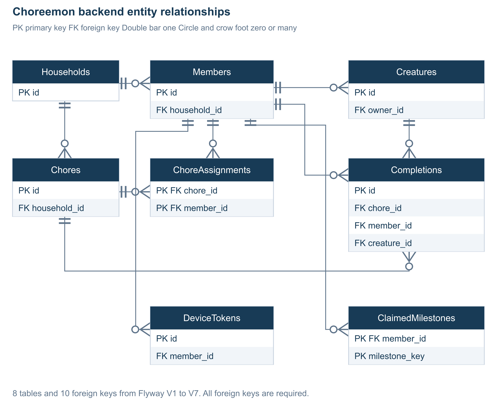

# Choreemon entity relationship model

Reviewed 19 October 2026 | Physical schema from Flyway migrations V1 through V7

## Schema overview

The backend defines eight tables and ten foreign keys. This is the schema declared by the migration files, not a database introspection result. The Android app stores one JSON aggregate in SharedPreferences and does not create these SQL tables. Its entity lists map conceptually to this model, while assignments are embedded member ID lists and milestones are string keys in the local save. [A3, A4, B5, V1 to V7]

The diagram uses one at the referenced end and zero or many at the referencing end. Every declared foreign key is NOT NULL. A parent row can exist without children. Composite primary keys in ChoreAssignments and ClaimedMilestones identify a pair. The full diagram with every column is available as diagrams/er-full.svg, with editable Mermaid source in diagrams/er-diagram.mmd and Graphviz source in diagrams/er-full.dot.

## Relationships

| Parent | Child and foreign key | Cardinality |
| --- | --- | --- |
| Households.id | Members.household_id | One household to zero or many members |
| Households.id | Chores.household_id | One household to zero or many chores |
| Members.id | Creatures.owner_id | One member to zero or many creatures |
| Chores.id | ChoreAssignments.chore_id | One chore to zero or many assignments |
| Members.id | ChoreAssignments.member_id | One member to zero or many assignments |
| Chores.id | Completions.chore_id | One chore to zero or many completions |
| Members.id | Completions.member_id | One member to zero or many completions |
| Creatures.id | Completions.creature_id | One creature to zero or many completions |
| Members.id | DeviceTokens.member_id | One member to zero or many device tokens |
| Members.id | ClaimedMilestones.member_id | One member to zero or many milestone claims |

## Data dictionary

Types and defaults below are taken directly from migration SQL. PK means primary key; FK means foreign key; UK means unique key or index. Blank default means none is declared. All columns are NOT NULL except Members.auth_email and Members.auth_password_hash. Empty strings are stored values rather than SQL NULL.

### Households

Tenant root, invite code and parent PIN verifier. week_start and created_at are strings. The API currently exposes verifier fields and must use a safer DTO. [B7](source-index.md#b7), [V1](source-index.md#v1)

| Column | SQL type | Key | Nullable | Default |
| --- | --- | --- | --- | --- |
| id | NVARCHAR(36) | PK | No |  |
| name | NVARCHAR(100) |  | No |  |
| invite_code | NVARCHAR(12) | UK | No |  |
| pin_salt | NVARCHAR(32) |  | No |  |
| pin_hash | NVARCHAR(64) |  | No |  |
| week_start | NVARCHAR(10) |  | No |  |
| created_at | NVARCHAR(50) |  | No |  |

### Members

Household profile and counters. Email and password hash are optional, permitting child profiles without login credentials. points is spendable balance, not lifetime earned points. [B13](source-index.md#b13), [B15](source-index.md#b15), [V2](source-index.md#v2)

| Column | SQL type | Key | Nullable | Default |
| --- | --- | --- | --- | --- |
| id | NVARCHAR(36) | PK | No |  |
| household_id | NVARCHAR(36) | FK to Households.id | No |  |
| auth_email | NVARCHAR(256) | UK when not null | Yes |  |
| auth_password_hash | NVARCHAR(256) |  | Yes |  |
| name | NVARCHAR(64) |  | No |  |
| avatar | INT |  | No | 0 |
| points | INT |  | No | 0 |
| weekly_points | INT |  | No | 0 |
| is_parent | BIT |  | No | 0 |

### Creatures

Owned companions. Element, rarity and stage determine displayed species; XP determines level. is_active is persisted but not included as a field in the public Creature model. [B18](source-index.md#b18), [B24](source-index.md#b24), [V3](source-index.md#v3)

| Column | SQL type | Key | Nullable | Default |
| --- | --- | --- | --- | --- |
| id | NVARCHAR(36) | PK | No |  |
| owner_id | NVARCHAR(36) | FK to Members.id | No |  |
| element | NVARCHAR(10) |  | No |  |
| rarity | NVARCHAR(12) |  | No |  |
| xp | INT |  | No | 0 |
| stage | INT |  | No | 0 |
| nickname | NVARCHAR(64) |  | No | '' |
| adopted_date | NVARCHAR(10) |  | No |  |
| loved_on | NVARCHAR(10) |  | No | '' |
| is_favorite | BIT |  | No | 0 |
| is_active | BIT |  | No | 0 |

### Chores

Household quests. steps contains a JSON array encoded as text. Archiving is a flag, preserving references and historical completion snapshots. [B16](source-index.md#b16), [V4](source-index.md#v4)

| Column | SQL type | Key | Nullable | Default |
| --- | --- | --- | --- | --- |
| id | NVARCHAR(36) | PK | No |  |
| household_id | NVARCHAR(36) | FK to Households.id | No |  |
| title | NVARCHAR(100) |  | No |  |
| description | NVARCHAR(500) |  | No | '' |
| points | INT |  | No |  |
| element | NVARCHAR(10) |  | No |  |
| schedule | NVARCHAR(12) |  | No | 'DAILY' |
| requires_approval | BIT |  | No | 0 |
| archived | BIT |  | No | 0 |
| steps | NVARCHAR(MAX) |  | No | '[]' |

### ChoreAssignments

Join table for chore-to-member assignments. Its composite key rejects duplicate pairs, but does not enforce matching household IDs between chore and member. [V4](source-index.md#v4)

| Column | SQL type | Key | Nullable | Default |
| --- | --- | --- | --- | --- |
| chore_id | NVARCHAR(36) | PK, FK to Chores.id | No |  |
| member_id | NVARCHAR(36) | PK, FK to Members.id | No |  |

### Completions

Submission and reward snapshot. title, points and xp preserve values at submission. photo_url is an unstructured reference, with no Photos table or FK. [B10](source-index.md#b10), [B17](source-index.md#b17), [V5](source-index.md#v5)

| Column | SQL type | Key | Nullable | Default |
| --- | --- | --- | --- | --- |
| id | NVARCHAR(36) | PK | No |  |
| chore_id | NVARCHAR(36) | FK to Chores.id | No |  |
| member_id | NVARCHAR(36) | FK to Members.id | No |  |
| creature_id | NVARCHAR(36) | FK to Creatures.id | No |  |
| date | NVARCHAR(10) |  | No |  |
| title | NVARCHAR(100) |  | No |  |
| points | INT |  | No |  |
| xp | INT |  | No |  |
| status | NVARCHAR(10) |  | No | 'PENDING' |
| photo_url | NVARCHAR(500) |  | No | '' |

### DeviceTokens

Messaging registrations associated with members. The repository checks for a matching member and token before inserting, but no corresponding unique database constraint exists. [B15](source-index.md#b15), [V6](source-index.md#v6)

| Column | SQL type | Key | Nullable | Default |
| --- | --- | --- | --- | --- |
| id | NVARCHAR(36) | PK | No |  |
| member_id | NVARCHAR(36) | FK to Members.id | No |  |
| fcm_token | NVARCHAR(256) |  | No |  |
| platform | NVARCHAR(10) |  | No | 'ANDROID' |
| updated_at | NVARCHAR(50) |  | No |  |

### ClaimedMilestones

Award claim keys. The composite primary key prevents duplicate claims for the same member and key; it does not transact the wallet award with the claim. [B8](source-index.md#b8), [V7](source-index.md#v7)

| Column | SQL type | Key | Nullable | Default |
| --- | --- | --- | --- | --- |
| member_id | NVARCHAR(36) | PK, FK to Members.id | No |  |
| milestone_key | NVARCHAR(64) | PK | No |  |
| claimed_at | NVARCHAR(50) |  | No |  |

## Indexes and integrity rules

V1 declares unique invite_code. V2 indexes Members.household_id and creates a filtered unique index on nonnull auth_email. V3 indexes Creatures.owner_id. V4 indexes Chores.household_id. V5 indexes Completions.member_id and status. V6 indexes DeviceTokens.member_id. Each table also has its declared primary key. No cascading delete or update behavior is explicitly declared, so SQL Server uses its default referential actions. [V1 to V7]

The migration DDL is the physical type authority. Exposed maps text columns through varchar or text abstractions, while migrations declare NVARCHAR; the ORM declarations do not replace the migration schema. SQL constraints do not validate JSON steps, permitted enum strings, nonnegative points or XP, stage bounds, date formatting, a single active creature per owner, same-household assignments, or completion member-to-creature ownership. There is no unique quest occurrence constraint for nonrejected completions. [B5, V1 to V7]

Completion records do not store household_id directly; household filtering joins through Members. The three independent completion FKs do not ensure that chore, member and creature belong to the same household or owner. ChoreAssignments similarly lacks a composite tenant relationship. Those invariants require application checks or a redesigned schema with enforceable tenant keys. [B17](source-index.md#b17), [V4](source-index.md#v4), [V5](source-index.md#v5)

## Mapping from Android state

| Android value | Backend representation |
| --- | --- |
| GameState.household and inviteCode | Households.name and invite_code; Android has no household ID field |
| GameState.members | Members rows; backend adds household, identity and parent role fields |
| Creature.owner | Creatures.owner_id |
| GameState.activeCreature | Creatures.is_active selected by owner and returned as one aggregate ID |
| Chore.assigned | ChoreAssignments rows |
| Chore.steps | JSON text in Chores.steps |
| Completion.photo | Completions.photo_url; local Android value is a content URI |
| GameState.claimedMilestones | ClaimedMilestones rows scoped to a member |
| Preferences and onboarded | No dedicated backend persistence |
| Mood, level, species, streak and rank | Derived values; no independent columns |

Android PIN hashes use salted SHA256 while backend hashes use BCrypt on PIN plus a salt. Copying the local hash will not produce a working backend verifier. Local content URIs also cannot become server proof URLs without uploading and authorizing the corresponding image. [A3](source-index.md#a3), [B19](source-index.md#b19)

## Recommended schema changes

1. Add database constraints for valid numeric ranges and a filtered unique active-creature-per-owner rule, coordinated with transactional active selection.
2. Design quest occurrence identity for daily and one-time schedules, including rejected retries, and enforce it with atomic command processing.
3. Add photo metadata and private object keys with household and uploader FKs, content status, size and retention fields.
4. Add a reward or wallet ledger and idempotency records if durable reconciliation, historical weekly totals and safe retries are required.
5. Add audit and notification outbox tables if review attribution and reliable asynchronous delivery are required.
6. Consider native DATE and timestamp types, validated steps JSON, token uniqueness and tenant-aware relationship constraints in future migrations.

These recommendations are not present in V1 through V7 and are intentionally excluded from the physical ER diagram. Any schema change needs a new migration and tests against actual SQL Server behavior. Evidence IDs resolve in source-index.md and source hashes are recorded in evidence.json.
