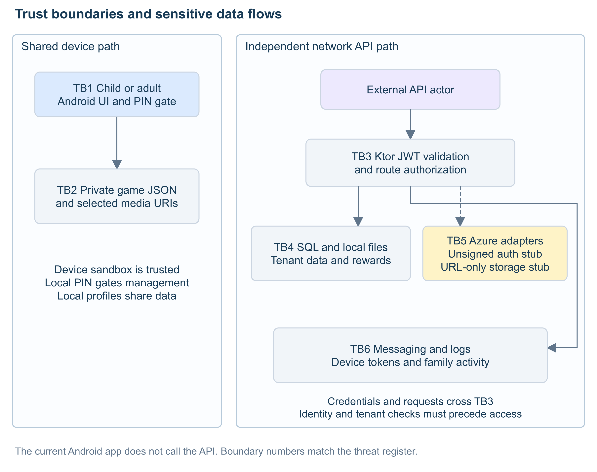

# Choreemon threat model

Reviewed 19 October 2026 | Audience Engineering and security reviewers

## Security assessment

The offline Android app has a small remote attack surface because it has no network integration. Its parent PIN is a local management gate on a shared device. The separate backend is not ready for untrusted network exposure. Its Azure verifier accepts unsigned tokens, several parent operations do not enforce household ownership, photo access is not tenant scoped, and business commands lack atomic transaction boundaries. These are source findings; no live compromise or deployed exposure is asserted. [A1, A5, B1, B9 to B12, B20]

Prioritize the conditional authentication bypass, default signing configuration, household authorization, PIN verifier disclosure and concurrent reward integrity before connecting clients. Production controls such as TLS termination, network restrictions, managed identity and monitoring are recommendations until their deployed configuration is verified.

## Scope and method

This model covers the Android source, Ktor routes, authentication and storage adapters, repositories, migrations, Dockerfile and Compose configuration. It uses STRIDE: spoofing, tampering, repudiation, information disclosure, denial of service and elevation of privilege. The unit of analysis is a data flow crossing a trust boundary. Local device access, authenticated children, parents from another household and external attackers are distinct threat actors.

Code paths and migration constraints were inspected directly. External references support security practices and version-specific behavior. This is a static assessment, not a penetration test, cloud configuration audit, legal compliance assessment or dependency advisory scan. Finding confidence indicates source evidence; exploitability may still depend on deployment mode, known target IDs or concurrent request timing.

## Assets and intended policy

| Asset | Protection requirement |
| --- | --- |
| Parent account and JWT signing material | Only the legitimate identity may act with parent authority; signing secrets remain server side |
| Household membership and invite code | Enrollment requires authorized household intent; unrelated households remain isolated |
| Member names and child activity history | Limit disclosure to authorized household participants and operational need |
| Photo proof | Private household object access, controlled collection, retention and deletion |
| PIN verifier and password hashes | Never disclose verifiers to clients; prevent cheap guessing and protect stored credentials |
| Wallet, XP, weekly score and milestone history | Rewards and spending remain consistent under retries and concurrency |
| SQL database and uploaded files | Integrity, bounded resource use, backups and tested restoration |
| Device messaging tokens and notification content | Bind recipients to authorized members and minimize personal data in logs and lock-screen messages |

Intended policy: a child acts on their own profile and companions, while a parent manages only their own household. Existing shared-device profile switching is intentional and provides no private separation among local children. Parent PIN verification is not an online login and its boolean response must not be treated as a token upgrade. [A1](source-index.md#a1), [B7](source-index.md#b7), [B11](source-index.md#b11)

## Data flows and trust boundaries

| Boundary | Crossing | Existing control and limitation |
| --- | --- | --- |
| TB1 Shared device to parent UI | A child attempts management operations | PIN dialog, five attempts then 30-second UI delay, relock on background; dialog state is not a persistent security service |
| TB2 Android process to local storage and media provider | Game JSON and selected image URI | Private app preferences, backup disabled, picker grant; JSON has no app-level integrity protection |
| TB3 API client to Ktor | Credentials, JWTs, JSON and multipart bodies | JWT wrapper, parent or owner checks on some routes; no application rate limits or deployment TLS configuration demonstrated |
| TB4 Ktor to SQL and filesystem | Reads, reward writes and photo bytes | SQL foreign keys and per-method transactions; tenant scoping and command atomicity are incomplete |
| TB5 Backend to identity and cloud adapters | Authentication or storage in Azure mode | Current adapters are stubs; verifier accepts none algorithm and storage does not upload bytes |
| TB6 Backend to FCM and logs | Tokens, names, quest descriptions and result data | Legacy sender, error token logging and development body logging; durable delivery and privacy filtering absent |

The Android and API client paths are separate. TB3 represents arbitrary or future API clients; it does not imply that the current app sends requests. SQL Server and filesystem operators are privileged actors. Tenant data read through API authorization remains untrusted even when the request contains a valid token. [A3, A5, A6, B1, B4, B19 to B23]

## Risk scoring

Likelihood and impact are scored from 1 to 5. Likelihood 1 requires unusual privileged conditions, 3 requires a practical prerequisite, and 5 needs little effort once the interface is reachable. Impact 1 affects a minor local action, 3 affects one member or availability, and 5 compromises household isolation or broad authentication. Score is likelihood multiplied by impact: 20 to 25 Critical, 12 to 19 High, 6 to 11 Medium and 1 to 5 Low. These are prioritization estimates rather than CVSS scores.

| ID | Finding | STRIDE | L x I | Priority |
| --- | --- | --- | --- | --- |
| T01 | Unsigned JWTs accepted in Azure mode | S E | 5 x 5 = 25 | Critical conditional |
| T02 | Default signing secret can remain active | S E | 4 x 5 = 20 | Critical conditional |
| T03 | Parent mutations omit household ownership | T E | 4 x 5 = 20 | Critical |
| T04 | PIN verifier and reusable invite code disclosure | I S | 4 x 4 = 16 | High |
| T05 | Photo reads lack owner metadata and tenant checks | I | 3 x 5 = 15 | High |
| T06 | Reward and purchase commands can race or partially commit | T R | 4 x 4 = 16 | High |
| T07 | Public enrollment and credential endpoints lack abuse controls | S D E | 4 x 4 = 16 | High |
| T08 | File handling lacks application validation and containment | T I D | 3 x 4 = 12 | High |
| T09 | Missing server validation permits invalid game data | T D | 4 x 3 = 12 | High |
| T10 | Development services and database authority may be exposed | I T D | 3 x 4 = 12 | High conditional |
| T11 | Notification audience and logging disclose family activity | I | 3 x 3 = 9 | Medium |
| T12 | Local PIN and save rely on device security | S T E | 3 x 3 = 9 | Medium local |
| T13 | Audit and session lifecycle leave abuse hard to contain | R S | 3 x 3 = 9 | Medium |
| T14 | Unbounded history and request work can exhaust service capacity | D | 3 x 3 = 9 | Medium |

All findings remain open in this documentation delivery. Conditional risks apply only when the specified configuration or deployment exposure occurs. High confidence means the relevant code pattern is present; it does not mean an exploit was run.

## Detailed threat register

### T01 Unsigned tokens in Azure mode

AzureB2CAuth.verifier uses JWT.require(Algorithm.none()) without issuer or audience restrictions. Application validates only that userId and householdId are present; parent routes trust isParent. An external actor reaching an ENV=azure instance can supply an unsigned token claiming known or chosen household identifiers and parent authority. Token generation in that adapter also returns an empty string, so normal enrollment is incomplete. Confidence is high; exposure is conditional on selecting Azure mode. [B1](source-index.md#b1), [B2](source-index.md#b2), [B20](source-index.md#b20)

Remediation: fail startup for an unimplemented provider. Implement signature verification using the selected identity provider metadata and key rotation, require the expected issuer, API audience and expiry, and resolve internal membership and roles from trusted server state. A generic valid identity token must not be sufficient to select an arbitrary household. Acceptance: unsigned, wrong-key, wrong-issuer, wrong-audience, expired and missing-required-claim tokens return 401; a valid signed identity cannot assert another member's household or parent role.

### T02 Default signing configuration

AppConfig supplies a fixed development JWT secret and a seven-day token duration when configuration is absent. LocalJwtAuth uses HMAC256 and verifies issuer and token signature. If a reachable instance retains the known fallback, attackers can mint valid signed tokens with arbitrary internal claims. The default being in source does not establish that a real production secret has leaked. Confidence is high and deployment dependent. [B3](source-index.md#b3), [B19](source-index.md#b19)

Remediation: require a strong externally supplied secret for nondevelopment environments, reject fallback values, rotate credentials and document affected token invalidation. Keep issuer and audience configuration explicit. Acceptance: startup fails with missing or sample signing values outside development; tokens from an old signing key stop authorizing according to a documented rotation procedure.

### T03 Cross household parent operations

PUT and DELETE /chores/{id} check isParent but update a chore by ID without comparing its household. POST /completions/{id}/review checks parent status and loads the completion by ID with no household predicate. A parent in household A who learns a household B object UUID can edit or archive B's quest or approve or reject B's pending completion. Assignment writes also accept member IDs from another household; foreign keys establish existence, not common tenancy. UUID unpredictability reduces discovery but is not authorization. Confidence is high. [B9](source-index.md#b9), [B10](source-index.md#b10), [B16](source-index.md#b16), [B17](source-index.md#b17), [V4](source-index.md#v4), [V5](source-index.md#v5)

Remediation: require householdId in repository mutations and derive ownership through the authoritative chore or member relationship. Verify all assigned members belong to the same household. Return a consistent 403 or 404 for inaccessible IDs. Acceptance: with two households and valid parent tokens, every foreign object mutation fails and leaves chores, assignments, status, wallet and XP unchanged. The design follows [OWASP object authorization guidance](https://api-security.owasp.org/editions/2023/en/0xa1-broken-object-level-authorization/).

### T04 Household secrets in API responses

GET /household copies pinSalt and pinHash into GameState for any household JWT, including children. Register, login and join also serialize HouseholdRecord, which contains the verifier fields and invite code. BCrypt increases guessing cost, but the PIN has low entropy and the verifier enables offline attempts. The public join route allows the reusable invite code to create another child token. Confidence is high. [B6](source-index.md#b6), [B7](source-index.md#b7), [B14](source-index.md#b14), [B19](source-index.md#b19)

Remediation: return dedicated household DTOs without verifiers, expose enrollment material only to authorized parents, rotate leaked invite codes, and use limited or expiring enrollment grants with parent confirmation. Acceptance: recursively inspect every auth and household response and find no PIN salt, PIN hash or password hash; child tokens cannot retrieve invitation credentials; reused or expired invitation grants fail.

### T05 Cross household photo access

All photo routes require a JWT through Application, so anonymous file reads are not established. However GET /photos/{filename} checks neither household nor owner, and uploaded files have no ownership row. Any authenticated member who learns a filename can request that object. An unguessable filename is not an access policy, and a photo URL can be disclosed in application data. Confidence is high. [B1](source-index.md#b1), [B12](source-index.md#b12), [B21](source-index.md#b21)

Remediation: add photo metadata with household, uploader, content status, retention and object key. Authorize before streaming or issuing a short-lived private object URL. Require referenced proof to belong to the completion's household. Acceptance: same-household permitted reads succeed; anonymous and foreign-household reads fail; copying a proof ID or URL into another household's completion is rejected.

### T06 Nonatomic game commands

Completion insertion, points updates and XP updates are separate transactions. Review reads PENDING and later updates unconditionally, so simultaneous reviewers can both pass the status check and attempt rewards. Hatching checks a prior balance, creates a creature and later debits through a read-modify-write update that clamps balances to zero. Parallel requests can obtain more creatures than the wallet should fund. Milestone insertion and its 25-point update are separate; a failure after insertion can lose the reward permanently even though the composite primary key prevents a second identical key. Concurrent point and XP writes can also overwrite each other. Confidence is high for missing atomicity; exact race outcomes require runtime testing. [B8](source-index.md#b8), [B10](source-index.md#b10), [B11](source-index.md#b11), [B15](source-index.md#b15), [B17](source-index.md#b17), [B18](source-index.md#b18), [V5](source-index.md#v5), [V7](source-index.md#v7)

Remediation: transact each command end to end. Use conditional status transitions, atomic counter increments, a conditional debit requiring enough balance, a unique business occurrence key or equivalent constraint, and idempotency keys for retries. Model rejection and one-time schedules explicitly so a uniqueness constraint does not block legitimate retries. Acceptance: parallel requests preserve wallet and XP arithmetic, approve once, charge every successful hatch, prevent duplicate eligible completions and grant each milestone exactly once; injected failures roll back all associated state.

### T07 Authentication and enrollment abuse

Register and login have no route-level rate limits. Register accepts any nonblank password; there is no verification or recovery flow. Public join uses a reusable six-character household code with no expiry, parent confirmation or household member cap. Backend PIN verification also has no attempt limit. A known or guessed code admits a new child profile with household read access. Brute-force cost is deployment dependent; no claim is made that the entire code space is cheap to exhaust. Child tokens have no implemented renewal route. Confidence is high. [B6](source-index.md#b6), [B7](source-index.md#b7), [B14](source-index.md#b14)

Remediation: add quotas per IP, account and household; bound hashing cost through request limits; use expiring enrollment grants; require parent acceptance; define password policy, account recovery and child session lifecycle. Acceptance: sustained attempts are throttled, expired or replayed invites fail, parent confirmation is enforced and member limits hold under concurrency.

### T08 Upload validation and filesystem containment

PhotosRoutes accepts the client extension and MIME declaration and writes each file part. No application byte budget, image signature check, pixel limit, file-count rule or cleanup policy is configured. Ktor or an ingress may impose its own limits, which were not verified. LocalFileStorage resolves File(baseDir, fileName) without a canonical containment check. Traversal through encoded paths or malicious filename suffixes is a hypothesis requiring route and container validation; source alone does not prove an arbitrary-file-read exploit. Confidence is high for missing checks and medium for traversal exploitability. [B12](source-index.md#b12), [B21](source-index.md#b21)

Remediation: bound bytes and file count, decode and reencode approved image formats with pixel limits, generate the entire object name server side, verify normalized containment, reject path separators and implement cleanup and per-household storage quotas. Follow the [OWASP upload guidance](https://cheatsheetseries.owasp.org/cheatsheets/File_Upload_Cheat_Sheet.html). Acceptance: oversized, deceptive and disallowed files fail before persistence, malformed or traversal names cannot escape uploads, and one household cannot consume unlimited storage.

### T09 Server validation gaps

Backend create and update routes do not apply the Android quest validator. Numeric point bounds, step counts and assigned household IDs are unchecked. Invalid point values can affect wallet arithmetic and may overflow counters; long fields can reach database errors. PIN update checks length 4 to 6 but does not require digits. A known parent's token can therefore create invalid state, while cross-household assignment compounds T03. Confidence is high. [A4, B7, B9, B16, V2 to V5]

Remediation: validate merged update state, constrain enums and lengths, validate related IDs and add database CHECK constraints for nonnegative counters and permitted stages and values. Acceptance: negative or excessive points, oversized inputs, empty or excessive steps and foreign assignments return a defined 4xx response and do not persist data.

### T10 Development infrastructure exposure

Compose publishes database, API and MinIO ports without a loopback-only binding. Configuration includes sample database and MinIO credentials; the default database user is sa. Docker starts a nonroot API process, which helps limit local privilege, but the SQL login is separate and highly privileged by default. Local JDBC encryption is disabled. No TLS ingress, firewall or secret-management configuration is present here. These risks apply if development configuration is exposed beyond a trusted host; actual network reachability was not tested. [B3](source-index.md#b3), [B4](source-index.md#b4), [B26](source-index.md#b26), [B27](source-index.md#b27)

Remediation: bind development services to loopback where appropriate, isolate database and storage networks, use a least-privileged application login, separate migration authority, require production secrets and configure HTTPS and SQL encryption. Acceptance: external probes cannot reach internal services, the runtime SQL identity cannot create arbitrary databases or administer the server, and sample secrets are rejected in production.

### T11 Notification and logging privacy

The pending-review recipient method does not filter parents. It also calls where twice, which Exposed 0.55 rejects, so the current path can fail after the completion is already committed. Fixing only that query would expose review messages to all other household members. Development notification logs include titles and bodies containing member and quest details; failures include the full device token. FCM responses are not checked for delivery errors. Confidence is high. [B10](source-index.md#b10), [B15](source-index.md#b15), [B23](source-index.md#b23)

Remediation: combine household, parent and exclusion predicates; minimize lock-screen content and logs; redact token values; handle delivery errors and invalid registrations. Use the current [FCM HTTP v1 protocol](https://firebase.google.com/docs/cloud-messaging/send/v1-api) or supported Admin SDK. Acceptance: only parent tokens receive review-needed messages, logs omit tokens and personal message bodies, and non-success sends trigger bounded retry or recorded failure.

### T12 Local save and PIN trust

Android uses a salted SHA256 verifier for a four-digit PIN in the same private JSON save as points and progress. Device sandboxing and backup disabling are useful protections, and the app applies an in-dialog five-attempt cooldown and background relock. Someone able to extract or modify app-private data can guess the PIN cheaply or change progress; a user may reset dialog-scoped cooldown state by reopening or restarting the flow. These are local risks, not remote account takeover. Confidence is high. [A1](source-index.md#a1), [A3](source-index.md#a3), [A5](source-index.md#a5), [A6](source-index.md#a6)

Remediation: decide whether the shared-device gate is sufficient for the product. For stronger assurance, use a costed password KDF and device-protected key material, persist cooldown state with a suitable clock policy, and move online parent authority to authenticated server roles. Acceptance: local UI throttling survives intended lifecycle events; malformed saves fail safely; server authorization does not rely on a client PIN verifier or modified local JSON.

### T13 Audit and session lifecycle

JWTs default to seven days, and the server does not look up current membership or role on each authenticated call. No revocation, refresh or server logout implementation exists. Generic request logging does not supply an immutable review audit trail with actor, household, time, decision and previous state. Stolen tokens remain useful until expiry or key invalidation, and disputed reviews are difficult to attribute. Confidence is high for missing code; operational audit retention is unverified. [B1](source-index.md#b1), [B3](source-index.md#b3), [B6](source-index.md#b6), [B10](source-index.md#b10), [B19](source-index.md#b19)

Remediation: define bounded sessions and revocation, validate current membership for sensitive commands, record security and review audit events, and alert on authorization failures and abuse patterns. Acceptance: revoked or removed identities lose access within the chosen bound and every review decision has a correlated actor and state transition without logging credentials.

### T14 Resource exhaustion

Household and completion reads load full history; completion submission reconstructs several household lists. Photo storage has no application quota and notification sends run sequentially within the request. Open registration can create records and invoke expensive BCrypt operations. A pool of 10 connections and unbounded history create predictable capacity pressure. Exact throughput is unknown. Confidence is high for the workload pattern. [B4](source-index.md#b4), [B6](source-index.md#b6), [B7](source-index.md#b7), [B10](source-index.md#b10), [B12](source-index.md#b12), [B23](source-index.md#b23)

Remediation: bound requests, add pagination and retention, limit per-household objects, cap notification fanout and use asynchronous delivery when needed. Acceptance: load tests with maximum supported household history stay within documented latency and memory limits, and abusive clients cannot monopolize database or storage capacity.

## Existing protections and assessment limits

Local JWT verification uses an explicit HMAC algorithm and issuer. Password hashing uses BCrypt cost 12. Most data queries use the Exposed DSL rather than string concatenation. Foreign keys and composite keys protect basic references and duplicate milestone keys. Creature update, love and evolution routes explicitly check owner IDs. Android uses private storage, no network permission, a system photo picker, backup disabling and parent relock. The runtime container declares a nonroot user. [A1, A3, A5, B4, B11, B19, B26, V1 to V7]

These controls do not close the separate tenant, transaction and provider gaps. No direct server fetch of photoUrl was found, so SSRF from that field is not established. CORS anyHost broadens browser access but does not itself bypass bearer authentication. The database bootstrap interpolates a trusted configuration name, which is different from a demonstrated request-driven SQL injection. Dependencies were inventoried without assigning unverified CVEs. Azure storage and identity placeholders are not evidence that cloud services are configured securely or even deployed.

## Remediation sequence and ownership

Suggested ownership below is by role; no individual assignment is implied.

| Order | Suggested owner | Required outcome |
| --- | --- | --- |
| 1 Before any untrusted access | Backend and identity engineers | Close T01 to T04; fail incomplete auth modes and default secrets; authorize tenant-scoped mutations and remove verifiers |
| 2 Before mobile integration | Backend and data engineers | Close T05 to T09; transactional rewards, constrained data and private validated photos |
| 3 Before deployment review | Platform and backend engineers | Address T10, T11, T13 and T14; verify ingress, identities, observability, quotas and delivery |
| 4 Before stronger shared-device security claims | Android engineers and product owner | Resolve T12 and document the expected device trust model |

The double where query failure, unwired weekly rollover, Azure fake upload and Docker packaging mismatch also need functional fixes. A stable backend is necessary to run meaningful negative security tests. Each finding should be closed by its stated acceptance cases and code review; this document does not mark any finding remediated.

## Security validation scenarios

1. Create two households with separate parent and child test identities. Exercise every route with a missing token, child token, foreign parent token and authorized token.
2. Verify token algorithm, signature, issuer, audience and expiry rejection in every enabled environment; missing provider configuration must fail startup.
3. Inspect all response shapes for verifiers, invitation material and unrelated member data; test photo access using foreign household identities.
4. Submit parallel completion, approval, hatch, evolution and milestone commands. Inject failures after each SQL step and confirm atomic outcomes and retry behavior.
5. Test invitation replay, registration floods, credential attempts, PIN attempts and storage quotas using bounded local test fixtures.
6. Test upload byte, pixel, MIME, extension and traversal cases, including multiple file parts and interrupted streams.
7. Test Monday rollover, server and household timezone policy, delayed review and client clock changes with reproducible clocks.
8. Verify audit events and redaction, notification recipients, negative FCM responses and session revocation. Run restore exercises for database and photo storage.

## References and evidence

Evidence IDs resolve in source-index.md and evidence.json. The schema is documented separately in er-diagram.md. Sources consulted on 19 October 2026 include [OWASP API object authorization](https://api-security.owasp.org/editions/2023/en/0xa1-broken-object-level-authorization/), [OWASP file uploads](https://cheatsheetseries.owasp.org/cheatsheets/File_Upload_Cheat_Sheet.html), [Microsoft access token validation](https://learn.microsoft.com/en-us/entra/identity-platform/access-tokens#validate-tokens), [Firebase HTTP v1 sends](https://firebase.google.com/docs/cloud-messaging/send/v1-api) and the [Exposed 0.55 query implementation](https://raw.githubusercontent.com/JetBrains/Exposed/0.55.0/exposed-core/src/main/kotlin/org/jetbrains/exposed/sql/Query.kt). Recommendations based on these references are separate from the source-confirmed implementation findings.
