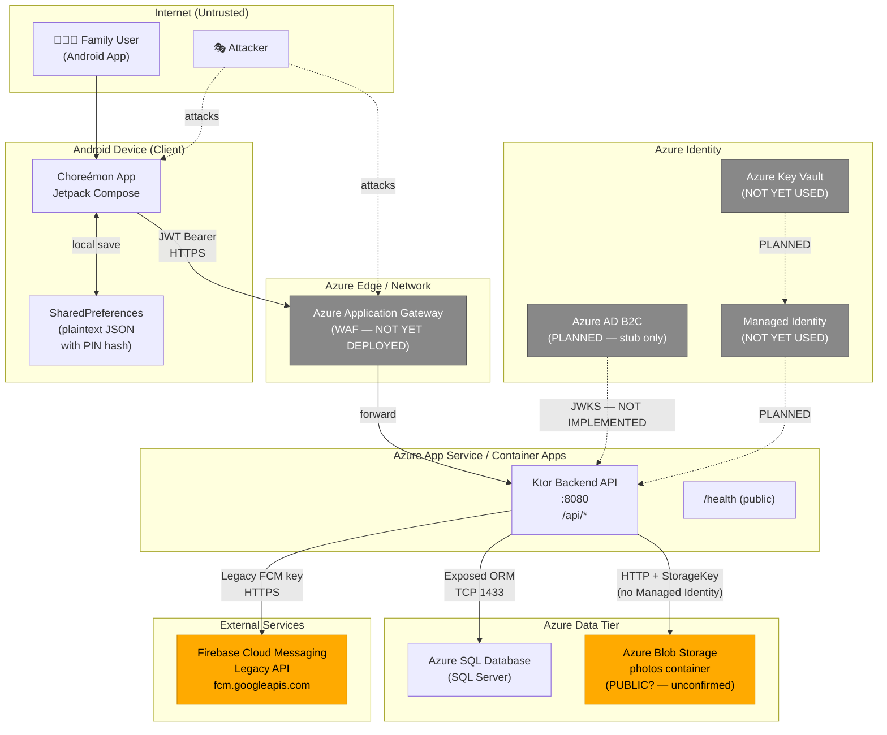
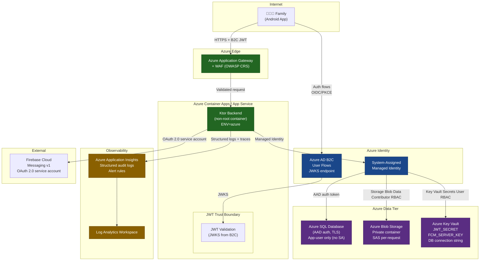

# Choreémon — Complete Azure Threat Model
**Prepared:** 2026-10-18  
**Assessor:** Antigravity (Senior AppSec / Cloud Security Architect)  
**Scope:** `choreemon-backend` (Ktor/Kotlin API) + `Chore-mon` (Android client) as proposed for Azure deployment  
**Status:** Analysis only. No files modified. No resources created. No credentials exposed.

---

## Table of Contents
1. [Application Understanding](#1-application-understanding)
2. [Architecture Diagram](#2-architecture-diagram)
3. [Asset Inventory](#3-asset-inventory)
4. [Threat Actors](#4-threat-actors)
5. [STRIDE Threat Modeling](#5-stride-threat-modeling)
6. [OWASP Top 10 Analysis](#6-owasp-top-10-analysis)
7. [API Security Assessment](#7-api-security-assessment)
8. [Authentication & Authorization Analysis](#8-authentication--authorization-analysis)
9. [Database Security](#9-database-security)
10. [Secrets & Credential Analysis](#10-secrets--credential-analysis)
11. [Dependency & Supply-Chain Analysis](#11-dependency--supply-chain-analysis)
12. [Frontend / Mobile Security](#12-frontend--mobile-security)
13. [File Upload Security](#13-file-upload-security)
14. [SSRF & External Requests](#14-ssrf--external-requests)
15. [Azure-Specific Threat Model](#15-azure-specific-threat-model)
16. [CI/CD & Deployment Pipeline Threats](#16-cicd--deployment-pipeline-threats)
17. [Threat Risk Scoring](#17-threat-risk-scoring)
18. [Threat Register](#18-threat-register)
19. [Attack Scenarios](#19-attack-scenarios)
20. [Secure Target Architecture](#20-secure-target-architecture)
21. [Remediation Roadmap](#21-remediation-roadmap)
22. [Executive Summary](#22-final-executive-summary)

---

## 1. Application Understanding

### What the Application Does
Choreémon is a family chore-gamification system. Children complete household chores ("quests") to earn points and XP, which are used to hatch and evolve virtual creatures (Pokémon-inspired). Parents manage households, approve completions, and set PINs. The system delivers push notifications via FCM.

### Architecture Components (Confirmed from Source)

| Component | Technology | Notes |
|---|---|---|
| **Client** | Android (Kotlin + Jetpack Compose) | Native app, currently offline-first; a compiled APK ships in the repo |
| **Backend API** | Ktor (Kotlin/JVM), runs on port 8080 | REST API under `/api/` prefix |
| **Database** | Microsoft SQL Server (MSSQL 2022 in Docker, Azure SQL in prod) | Managed via Flyway migrations + Exposed ORM |
| **File Storage (local)** | Local filesystem (`./uploads/`) | Served back via `/api/photos/{filename}` |
| **File Storage (Azure)** | Azure Blob Storage (stub implementation) | Container name: `photos` |
| **Authentication (local)** | Custom JWT (HMAC-256, `com.auth0:java-jwt`) + BCrypt passwords | 168-hour (7-day) token lifetime |
| **Authentication (Azure mode)** | Azure AD B2C (stub — JWKS verifier uses `Algorithm.none()`) | **CRITICAL: not implemented** |
| **Push Notifications** | Firebase Cloud Messaging (Legacy FCM HTTP v1 API) | Direct server key call |
| **Container** | Docker multi-stage build (Alpine JRE, non-root user) | |
| **Local Dev Orchestration** | docker-compose (SQL Server + MinIO + API) | |

### APIs
REST API under prefix `/api/`. Public: `/api/auth/*`. Protected (JWT): `/api/household`, `/api/members`, `/api/chores`, `/api/completions`, `/api/creatures`, `/api/leaderboard`, `/api/photos`. Health check: `/health` (no auth).

### External Services
- Firebase Cloud Messaging (push notifications via legacy server key)
- Azure Blob Storage (production photo storage)
- Azure AD B2C (planned auth provider — **not yet implemented**)

### File Uploads
Yes — photo proof of chore completion. Upload via `POST /api/photos/upload`. Served at `GET /api/photos/{filename}`.

### AI/ML Services
None confirmed in source.

### Background Jobs
None confirmed (no scheduler, no coroutine background loops).

### Email/SMS
None confirmed.

### Secrets/Configuration
Loaded entirely from environment variables with hardcoded fallback defaults in `AppConfig.kt`.

### Logging/Monitoring
Logback to stdout only. No structured logging, no Azure Application Insights integration, no audit trail.

### Major Trust Boundaries
1. **Internet ↔ Backend API** — JWT is the primary guard
2. **Backend API ↔ Database** — SQL Server TCP, credentials via env
3. **Backend API ↔ FCM** — Legacy server key over HTTPS
4. **Backend API ↔ Azure Blob Storage** — Storage account key over HTTPS
5. **Android App ↔ Backend API** — JWT bearer token
6. **Android App ↔ Local SharedPreferences** — plaintext JSON save, salted PIN hash

---

## 2. Architecture Diagram



**Legend:**
- 🔴 Red nodes: confirmed critical issues  
- 🟡 Yellow nodes: risks requiring verification  
- ⬛ Grey nodes: planned but not yet implemented

---

## 3. Asset Inventory

| Asset | Location | Importance | Confidentiality | Integrity | Availability |
|---|---|---|---|---|---|
| User email addresses | `Members` table, `auth_email` column | High | High | High | Medium |
| BCrypt password hashes | `Members` table, `auth_password_hash` column | Critical | Critical | Critical | Medium |
| JWT signing secret | Env: `JWT_SECRET`; fallback default in `AppConfig.kt` | Critical | Critical | Critical | High |
| Parent household PIN hash | `Households` table, `pin_hash`/`pin_salt`; Android SharedPreferences | High | High | High | Medium |
| PIN salt (8-char UUID prefix) | `Households` table, Android SharedPreferences | High | High | Medium | Medium |
| JWT tokens (in-flight) | Android memory / HTTP headers | High | High | High | Medium |
| FCM server key | Env: `FCM_SERVER_KEY` | High | Critical | Medium | Medium |
| Azure Storage account key | Env: `AZURE_STORAGE_KEY` | Critical | Critical | High | High |
| Azure B2C client credentials | Env: `AZURE_B2C_CLIENT_ID` | High | Critical | High | Medium |
| Database credentials (`DB_USER`/`DB_PASSWORD`) | Env vars; hardcoded fallbacks in `AppConfig.kt` | Critical | Critical | Critical | High |
| MinIO access/secret keys | Env: `STORAGE_ACCESS_KEY`/`STORAGE_SECRET_KEY`; hardcoded in `AppConfig.kt` | High | Critical | High | Medium |
| Photo uploads (chore proof images) | Azure Blob `photos` container / local `./uploads/` | Medium | Medium | Medium | Medium |
| Member activity data (completions, streaks) | `Completions` table | Medium | Medium | High | Medium |
| FCM device tokens | `DeviceTokens` table | Medium | High | Medium | Medium |
| Household invite codes | `Households` table, API responses | Medium | Medium | Medium | Low |
| Backend source code | Git repository | High | High | Critical | Low |
| Database (full) | Azure SQL / MSSQL Docker | Critical | Critical | Critical | Critical |
| Docker image | ACR (planned) / local build | High | High | High | Medium |

---

## 4. Threat Actors

Ranked by relevance to this application:

### 1. 🔴 Malicious Authenticated User (HIGH relevance)
A child or parent with a valid JWT token attempting to manipulate points, approve their own completions, or access other households' data. The application has family members — some children — whose tokens are valid but must be scoped to their household. **Most exploitable with current IDOR gaps.**

### 2. 🔴 External Attacker (HIGH relevance)
An unauthenticated internet attacker scanning for open endpoints, attempting credential stuffing on `/api/auth/login`, brute-forcing invite codes, or exploiting the file upload endpoint. No rate limiting exists.

### 3. 🟡 Compromised Account (MEDIUM relevance)
An attacker who stole a valid JWT (e.g., via device theft, network interception, or a leaked token). Tokens live 168 hours with no revocation mechanism.

### 4. 🟡 Supply-Chain Attacker (MEDIUM relevance)
Compromised Gradle/Maven dependency. The build pulls from `mavenCentral()`. No dependency lock file (no `gradle.lockfile`).

### 5. 🟡 Cloud Attacker (MEDIUM relevance)
Exploiting misconfigured Azure resources — e.g., publicly accessible Blob container, exposed SQL firewall, or leaked Azure Storage key.

### 6. 🟠 Automated Attacker (MEDIUM relevance)
Bots brute-forcing login, harvesting invite codes (6-char alphanumeric = ~32^6 ≈ 1 billion combinations but no lockout), or spamming chore-completion to inflate points.

### 7. 🟢 Malicious Insider (LOW relevance)
A developer with Azure or database access. Low relevance for a small family app but increases if/when a real team manages the backend.

### 8. 🟢 Automated Scraper (LOW relevance)
Leaderboard or household data scraping. Low business impact for a family-oriented app.

---

## 5. STRIDE Threat Modeling

### Spoofing

**S1 — CRITICAL: `AzureB2CAuth.verifier()` uses `Algorithm.none()`**
- **Evidence:** `AzureB2CAuth.kt` line 15: `return JWT.require(Algorithm.none()).build()`
- **Impact:** If `ENV=azure` is set, *any* JWT — including one created by an attacker with no signature — is accepted as valid. This is a complete authentication bypass.
- **Note:** The current production deployment path appears to use `ENV=local`, but this is a time-bomb for production.

**S2 — HIGH: Weak default JWT secret**
- **Evidence:** `AppConfig.kt` line 24: `secret = env("JWT_SECRET", "dev-secret-CHANGE-IN-PRODUCTION")`
- **Impact:** If the env var is not set (e.g., during a misconfigured deployment), the fallback secret `dev-secret-CHANGE-IN-PRODUCTION` is used. An attacker who discovers this can mint arbitrary JWTs with any `userId`, `householdId`, and `isParent=true`.

**S3 — HIGH: No JWT token revocation**
- **Evidence:** `LocalJwtAuth.kt` — `expiryHours = 168`. No blocklist, no refresh mechanism.
- **Impact:** Stolen tokens are valid for 7 days with no way to invalidate them.

**S4 — MEDIUM: Invite code brute-force**
- **Evidence:** `HouseholdRepository.kt` — 6-char code from a 32-char alphabet. No rate limiting on `POST /api/auth/join`.
- **Impact:** Attacker can enumerate invite codes and join arbitrary households as a child member.

**S5 — MEDIUM: Account enumeration on login**
- **Evidence:** `AuthRoutes.kt` lines 102-109 — different code paths for "user not found" vs "wrong password" both return the same message ("Invalid credentials"), which is good. However, `POST /api/auth/register` line 49 returns `409 Conflict` with "An account with this email already exists," enabling email enumeration.

**S6 — MEDIUM: No brute-force protection on login**
- **Evidence:** `AuthRoutes.kt` — no rate limiting, no account lockout on `POST /api/auth/login`.

---

### Tampering

**T1 — HIGH: IDOR on chore update/delete — no household ownership check**
- **Evidence:** `ChoresRoutes.kt` lines 81-117 — `PUT /api/chores/{id}` and `DELETE /api/chores/{id}` check `isParent` (from JWT) but do NOT verify that the chore belongs to the caller's household. A parent from Household A can update/delete chores belonging to Household B if they know the chore ID.
- **Impact:** Cross-household data corruption.

**T2 — HIGH: IDOR on completion review — no household membership check**
- **Evidence:** `CompletionsRoutes.kt` lines 97-133 — `POST /api/completions/{id}/review` checks `isParent` but does NOT verify the completion belongs to the caller's household.
- **Impact:** A parent can approve completions in another household, granting illegitimate points.

**T3 — HIGH: Points manipulation — milestone endpoint has no server-side rate limit**
- **Evidence:** `MembersRoutes.kt` lines 79-104 — `POST /api/members/milestone` awards 25 points. The duplicate-check uses `claimedMilestones` keyed by `"$memberId:$milestone"` (where milestone = completionCount / 10), so re-triggering is prevented by game logic. However, if `claimMilestone` game rule passes, it always awards 25 points regardless. **Confirmed not infinitely exploitable** due to milestone key uniqueness — but the milestone threshold (`completionCount / 10`) is based on total completions, not verified approvals at the route layer.

**T4 — MEDIUM: Mass assignment on AddMemberRequest**
- **Evidence:** `MembersRoutes.kt` line 20 — `AddMemberRequest` includes `isParent: Boolean = false`. A parent can directly pass `isParent=true` to elevate a new member. This is legitimate for the parent role, but there is no cap on the number of parents in a household — any authenticated parent can create unlimited parent accounts.

**T5 — MEDIUM: File path traversal in local file storage**
- **Evidence:** `LocalFileStorage.kt` line 20 — `val target = File(baseDir, fileName)`. The `fileName` is generated server-side as `UUID.ext`, so this is mitigated in production. However, `PhotosRoutes.kt` line 38 — `val filename = call.parameters["filename"]` is directly passed to `registry.storage.getFile(filename)`. If `LocalFileStorage` is used, `File(baseDir, filename)` with an attacker-controlled `filename` (e.g., `../../application.conf`) could expose server files. **Confirmed risk in local mode.**

**T6 — LOW: Chore steps stored as raw JSON text in the database**
- **Evidence:** `ChoreRepository.kt` lines 30, 42 — `mapper.writeValueAsString(steps)` stored in `steps TEXT` column. Not a direct tampering risk, but deserialization of untrusted data is a concern.

---

### Repudiation

**R1 — HIGH: No audit log for security-sensitive actions**
- **Evidence:** `logback.xml` — only stdout, INFO level. No structured audit events for: user login, failed login, chore completion, approval/rejection, PIN change, household join, member creation, or photo upload.
- **Impact:** No forensic trail; attacker actions cannot be reconstructed.

**R2 — MEDIUM: Completion records can be created with arbitrary `photoUrl` strings**
- **Evidence:** `CompletionsRoutes.kt` line 18 — `photoUrl: String = ""` is accepted from the client without validation. A user can submit a completion with a fake or external URL as photo proof, which is stored and displayed to parents without verification.

**R3 — LOW: No request IDs in logs**
- **Evidence:** `Application.kt` line 27 — `install(CallLogging) { level = Level.INFO }`. No `requestId` or correlation ID generated. Log correlation across requests is impossible.

---

### Information Disclosure

**ID1 — CRITICAL: `pinSalt` and `pinHash` returned in `GET /api/household` response**
- **Evidence:** `HouseholdsRoutes.kt` lines 43-44 — `pinSalt = household.pinSalt, pinHash = household.pinHash` are included in the `GameState` response returned to any authenticated household member.
- **Impact:** Any member (including a child) can receive the household PIN hash and salt. The PIN hash is also stored in Android `SharedPreferences` in plaintext JSON. The salt is only 8 characters (UUID prefix), and the hash is BCrypt — but exposing the hash directly enables offline cracking with bcrypt tooling.

**ID2 — HIGH: `AzureBlobStorage` stub — uploaded files may land in a public container**
- **Evidence:** `AzureBlobStorage.kt` lines 10-13 — returns a `https://<account>.blob.core.windows.net/photos/<filename>` URL with no SAS token, no access tier specification. If the `photos` container is created with public blob access, all uploaded chore-proof photos are publicly accessible by anyone with the URL (which is UUID-named but guessable from API responses).
- **Status:** **Unverified** — depends on Azure Blob container configuration at deployment time.

**ID3 — HIGH: Weak fallback database password**
- **Evidence:** `AppConfig.kt` line 21: `password = env("DB_PASSWORD", "Local_Dev_P@ss1")`. If the env var is missing in production, the well-known dev password is used.

**ID4 — MEDIUM: FCM legacy API exposes server key in HTTP header**
- **Evidence:** `FcmDirectService.kt` line 44 — `header(HttpHeaders.Authorization, "key=$serverKey")`. FCM legacy server keys, if logged by middleware or intercepted, expose a capability to send push notifications to any registered FCM device token.

**ID5 — MEDIUM: `GET /api/photos/{filename}` — no authorization check**
- **Evidence:** `PhotosRoutes.kt` lines 37-45 — the route is inside the `authenticate("jwt")` block (from `Application.kt` line 89), so a JWT is required. However, any authenticated user in *any* household can retrieve any photo by filename. Photos are UUID-named, so enumeration is difficult but not impossible.

**ID6 — MEDIUM: Health endpoint leaks server status information without any auth**
- **Evidence:** `Application.kt` line 101 — `get("/health") { call.respond(mapOf("status" to "ok")) }`. While minimal, it confirms the server is running and its port. Low severity on its own but aids reconnaissance.

**ID7 — LOW: Android SharedPreferences stores full game state in plaintext**
- **Evidence:** `GameRepository.kt` lines 17-27 — `SaveCodec.encode(s)` serializes the complete `GameState` including `pinSalt`, `pinHash`, all member IDs, points, completions, and photo URLs into a JSON string stored in `SharedPreferences` (MODE_PRIVATE). On rooted devices, this data is accessible.
- **Note:** `android:allowBackup="false"` in `AndroidManifest.xml` mitigates cloud backup exposure.

---

### Denial of Service

**DoS1 — HIGH: No rate limiting anywhere**
- **Evidence:** No `RateLimit` plugin installed in `Application.kt`. No throttling in any route.
- **Impact:** Any endpoint can be hammered. High-cost operations (`POST /api/completions` executes multiple DB queries + FCM calls) are especially vulnerable.

**DoS2 — HIGH: File upload with no size limit**
- **Evidence:** `PhotosRoutes.kt` line 15 — `call.receiveMultipart()` with no `maxFileSize` configured.
- **Impact:** Attacker can upload arbitrarily large files, exhausting disk space (local) or incurring Azure Blob Storage costs.

**DoS3 — MEDIUM: `POST /api/completions` executes 5+ DB queries per request**
- **Evidence:** `CompletionsRoutes.kt` lines 43-48 — loads full household state (members, creatures, chores, completions) on every completion. Under load, this degrades rapidly.

**DoS4 — MEDIUM: Unconstrained FCM notification loops**
- **Evidence:** `ChoresRoutes.kt` lines 68-76 — sends FCM to each assigned member. No concurrency limit, no circuit breaker. A burst of chore-creation requests could flood FCM.

---

### Elevation of Privilege

**EoP1 — CRITICAL: `isParent` claim in JWT is client-trusted for all authorization**
- **Evidence:** All privileged routes (`POST /api/chores`, `PUT /api/chores/{id}`, `DELETE /api/chores/{id}`, `PUT /api/household/pin`, `POST /api/members`, `POST /api/completions/{id}/review`) check `isParent` from the JWT claim. JWT is signed server-side — this is correct. However:
  - **The `isParent` flag cannot be revoked or changed after token issuance.** A user who was a parent and has a live token remains a parent for 168 hours even if demoted.
  - **No server-side lookup against the database is done** to re-verify `isParent` at request time.

**EoP2 — HIGH: `POST /api/members` allows creating a parent member**
- **Evidence:** `MembersRoutes.kt` line 46 — `isParent = req.isParent`. An authenticated parent can create another parent. There is no maximum parent count or household-ownership guard. A child who obtains a parent JWT (e.g., via stolen device) can escalate permanently by creating a new parent account.

**EoP3 — HIGH: `POST /api/auth/join` creates members with no authentication**
- **Evidence:** `AuthRoutes.kt` lines 128-167 — anyone with a valid invite code joins as a child (`isParent = false`) and receives a JWT. No verification that the invite code was actually distributed to a family member.

**EoP4 — MEDIUM: Cross-household access via IDOR (see T1, T2)**
- A parent from Household A, by guessing/finding UUIDs from Household B, can mutate data in Household B.

---

## 6. OWASP Top 10 Analysis

| OWASP Category | Finding | Evidence | Severity | Recommendation |
|---|---|---|---|---|
| **A01 Broken Access Control** | IDOR on chore and completion routes — household membership not verified | `ChoresRoutes.kt:81`, `CompletionsRoutes.kt:97` | **HIGH** | Add household ownership check for every resource before mutation |
| **A01 Broken Access Control** | PIN hash returned to all authenticated members | `HouseholdsRoutes.kt:43` | **HIGH** | Strip `pinSalt`/`pinHash` from API responses; verify PIN server-side only |
| **A01 Broken Access Control** | No auth on `GET /api/photos/{filename}` for cross-household photos | `PhotosRoutes.kt:37` | **MEDIUM** | Validate photo belongs to caller's household or use per-request SAS tokens |
| **A02 Cryptographic Failures** | PIN hash returned to client (BCrypt hash exposed) | `HouseholdsRoutes.kt:43` | **HIGH** | Never return hashed credentials in API responses |
| **A02 Cryptographic Failures** | Android uses SHA-256 for PIN locally (not BCrypt); backend uses BCrypt — mismatch | `GameRepository.kt:52`, `LocalJwtAuth.kt:33` | **MEDIUM** | Harmonize PIN hashing; prefer server-side PIN verification only |
| **A02 Cryptographic Failures** | JWT secret has a hardcoded insecure default | `AppConfig.kt:24` | **HIGH** | Enforce non-default secret at startup; fail-fast if default is detected |
| **A03 Injection** | ORM (Exposed) used throughout — parameterized by default | All repositories | **LOW** | Confirmed safe; SQL Server via Exposed provides parameterization |
| **A03 Injection** | `createDatabaseIfNeeded` in `DatabaseFactory.kt` uses string interpolation in SQL statement | `DatabaseFactory.kt:50` | **MEDIUM** | The DB name comes from env (`DB_NAME`) — attacker needs env access, but sanitize anyway |
| **A04 Insecure Design** | No token revocation, no session management, 168-hour JWT lifetime | `AppConfig.kt:26` | **HIGH** | Reduce JWT lifetime; implement refresh tokens or a blocklist |
| **A04 Insecure Design** | `Algorithm.none()` used in Azure B2C auth stub | `AzureB2CAuth.kt:15` | **CRITICAL** | Implement proper JWKS-based B2C verification before `ENV=azure` is used |
| **A05 Security Misconfiguration** | `anyHost()` CORS — all origins allowed | `Application.kt:37` | **HIGH** | Restrict to known client origins |
| **A05 Security Misconfiguration** | No file upload size limit | `PhotosRoutes.kt:15` | **HIGH** | Set `maxFileSize` on multipart receiver |
| **A05 Security Misconfiguration** | Logging to stdout only, no structured/audit logging | `logback.xml` | **HIGH** | Add structured audit log; integrate with Azure Monitor |
| **A05 Security Misconfiguration** | Ktor development mode enabled when `ENV != azure` | `build.gradle.kts:11` | **MEDIUM** | Ensure `ENV=azure` is set or explicitly disable dev mode |
| **A06 Vulnerable & Outdated Components** | FCM Legacy HTTP API deprecated (replaced by FCM v1 / OAuth 2.0) | `FcmDirectService.kt` | **MEDIUM** | Migrate to FCM v1 HTTP API using service account OAuth |
| **A07 Auth Failures** | No brute-force protection on login | `AuthRoutes.kt:99` | **HIGH** | Implement account lockout or rate limiting |
| **A07 Auth Failures** | Email enumeration via 409 on register | `AuthRoutes.kt:49` | **MEDIUM** | Return generic message regardless of whether email exists |
| **A08 Software & Data Integrity** | No Gradle dependency lock file | `build.gradle.kts` | **MEDIUM** | Enable `gradle.lockfile` for reproducible builds |
| **A08 Software & Data Integrity** | Docker image from `eclipse-temurin` and `gradle` — no digest pinning | `Dockerfile:2,8` | **MEDIUM** | Pin base images by digest |
| **A09 Logging & Monitoring Failures** | No security event logging (login, failed login, privilege change) | All routes | **HIGH** | Add structured security event logging |
| **A10 Server-Side Request Forgery** | No user-controlled URL fetch in current code | N/A | **LOW** | Not applicable to current codebase |

---

## 7. API Security Assessment

| Endpoint | Method | Auth | Authorization | Main Risks | Severity |
|---|---|---|---|---|---|
| `/api/auth/register` | POST | None | None | Email enumeration, no rate limit, no email verification | MEDIUM |
| `/api/auth/login` | POST | None | None | Brute force, no lockout, no rate limit | HIGH |
| `/api/auth/join` | POST | None | Invite code only | Invite code brute force (6-char, no rate limit) | HIGH |
| `/api/auth/device-token` | POST | JWT | memberId from claim | FCM token stored without platform validation | LOW |
| `/health` | GET | None | None | Reconnaissance (acceptable) | INFO |
| `/api/household` | GET | JWT | householdId from claim | **Leaks `pinSalt`/`pinHash` to any household member** | HIGH |
| `/api/household/verify-pin` | POST | JWT | householdId from claim | No rate limit on PIN attempts | HIGH |
| `/api/household/pin` | PUT | JWT | isParent claim | No rate limit; PIN length only 4-6 digits | MEDIUM |
| `/api/members` | GET | JWT | householdId from claim | Low risk | LOW |
| `/api/members` | POST | JWT | isParent claim | Can create unlimited parents; no household cap | MEDIUM |
| `/api/members/{id}/streak` | GET | JWT | householdId claim | **No check that `{id}` belongs to caller's household** — IDOR | MEDIUM |
| `/api/members/milestone` | POST | JWT | memberId from claim | Points awarded without server-side re-verification of completions | MEDIUM |
| `/api/chores` | GET | JWT | householdId from claim | Low risk | LOW |
| `/api/chores` | POST | JWT | isParent claim | No input length validation on title/description/steps | MEDIUM |
| `/api/chores/{id}` | PUT | JWT | isParent claim | **No household ownership check — IDOR** | HIGH |
| `/api/chores/{id}` | DELETE | JWT | isParent claim | **No household ownership check — IDOR** | HIGH |
| `/api/completions` | GET | JWT | householdId from claim | Low risk | LOW |
| `/api/completions` | POST | JWT | memberId + householdId claims | No file size limit on photo; no chore-assignment verification | HIGH |
| `/api/completions/{id}/review` | POST | JWT | isParent claim | **No household ownership check — IDOR; can approve any completion** | HIGH |
| `/api/creatures` | GET | JWT | memberId from claim | Low risk | LOW |
| `/api/creatures/hatch` | POST | JWT | memberId + householdId claims | Points deduction race condition possible | LOW |
| `/api/creatures/{id}/evolve` | POST | JWT | owner check vs memberId | Good ownership check confirmed | LOW |
| `/api/creatures/{id}/love` | POST | JWT | owner check vs memberId | Good ownership check confirmed | LOW |
| `/api/creatures/{id}` | PATCH | JWT | owner check vs memberId | Good ownership check confirmed | LOW |
| `/api/leaderboard` | GET | JWT | householdId from claim | Low risk | LOW |
| `/api/photos/upload` | POST | JWT | householdId from claim | **No file size limit, no MIME validation, extension from filename** | HIGH |
| `/api/photos/{filename}` | GET | JWT | None (any auth user can fetch any photo) | Cross-household photo access | MEDIUM |

---

## 8. Authentication & Authorization Analysis

### Authentication Flow

**Registration (`POST /api/auth/register`):**
1. Email + password received
2. Email uniqueness checked
3. BCrypt (cost 12) applied to password ✅
4. PIN hashed: BCrypt(pin + 8-char UUID salt) ✅
5. Household + member created, JWT returned
6. **No email verification step** — anyone can register with any email ❌

**Login (`POST /api/auth/login`):**
1. Email lookup (case-insensitive via `.lowercase()`) ✅
2. BCrypt `verify()` on password ✅
3. Generic error message for not-found vs wrong-password ✅
4. JWT issued (168 hours, HMAC-256) ✅
5. **No rate limiting, no lockout** ❌

**Household Join (`POST /api/auth/join`):**
1. Invite code matched (case-insensitive) ✅
2. Child member created (isParent forced to false) ✅
3. JWT issued ✅
4. **No rate limiting on invite code attempts** ❌
5. **No existing-member check** — same person can join multiple times with different names ❌

**JWT Validation:**
- HMAC-256 signature ✅
- Issuer verified ✅
- Expiry enforced ✅
- Claims: `userId`, `householdId`, `isParent` — all custom claims
- **No `jti` (JWT ID) for revocation** ❌
- **No refresh token mechanism** ❌

**Azure B2C Mode:**
- `AzureB2CAuth.verifier()` returns `JWT.require(Algorithm.none()).build()` — **accepts any JWT regardless of signature** 🚨

### Authorization Analysis

| Action | Enforcement Location | Method | Verdict |
|---|---|---|---|
| Household data access | Server-side | JWT `householdId` claim | ✅ Correct |
| Parent-only actions (create chore, add member, review) | Server-side | JWT `isParent` claim | ✅ Correct for parent/child |
| Chore belongs to caller's household (update/delete) | **MISSING** | **None** | ❌ IDOR |
| Completion belongs to caller's household (review) | **MISSING** | **None** | ❌ IDOR |
| Photo belongs to caller's household | **MISSING** | **None** | ❌ IDOR |
| Creature ownership (evolve/love/patch) | Server-side | `creature.owner == memberId` | ✅ Correct |
| Milestone claim validity | Server-side (GameRules) | completion count check | ✅ Adequate |
| PIN verification rate limit | **MISSING** | **None** | ❌ |

**Cookie Security:** Not applicable — bearer JWT in Authorization header.

**Password Reset:** No password reset flow exists. This means users who forget passwords have no recovery path.

---

## 9. Database Security

### ORM & Query Safety
All database access uses JetBrains Exposed ORM with parameterized queries (`.where { Column eq value }`). **SQL injection via the ORM is not a confirmed risk** — Exposed uses PreparedStatements internally.

**Exception — `DatabaseFactory.kt` line 50:**
```kotlin
stmt.executeUpdate(
    "IF NOT EXISTS (SELECT name FROM sys.databases WHERE name = N'$name') CREATE DATABASE [$name]"
)
```
The `$name` value comes from the `DB_NAME` env variable. An attacker who controls this env var (e.g., via a supply-chain or config injection attack) could achieve SQL injection here. The brackets `[$name]` provide some quoting but do not fully prevent injection (e.g., `foo]; DROP DATABASE [master`). **Low exploitation probability** — requires env var control.

### Database Credentials
- Fallback password `Local_Dev_P@ss1` hardcoded in `AppConfig.kt`
- SA (system administrator) account is used as the DB user — **violates least privilege**. Azure SQL should use a dedicated low-privilege application user.

### Encryption
- Local: `trustServerCertificate=true`, `encrypt=false` — plaintext connection
- Azure: `encrypt=true`, `trustServerCertificate=false` ✅

### Sensitive Data Storage
- Password hashes: BCrypt cost 12 ✅
- PIN hash: BCrypt ✅ (backend); SHA-256 ❌ (Android client — weaker)
- PIN salt: 8-char UUID prefix (only 8 hex chars = 32 bits entropy) — **weak salt** for BCrypt
- No PII encryption at rest beyond Azure SQL TDE (if enabled)

### Access Control
- HikariCP connection pool, max 10 connections ✅
- No row-level security — application enforces tenant isolation in code ⚠️
- No database-level audit trail

### Backup & Recovery
No backup configuration in the codebase. Azure SQL automatic backups should be confirmed at deployment.

---

## 10. Secrets & Credential Analysis

### Confirmed Secrets in Source Code (Default Fallbacks)

```text
File: choreemon-backend/src/main/kotlin/com/choreemon/backend/config/AppConfig.kt
Line: 21
Secret type: Database password (default fallback)
Severity: HIGH
Recommended remediation: Remove hardcoded default; fail fast at startup if DB_PASSWORD is not set

File: choreemon-backend/src/main/kotlin/com/choreemon/backend/config/AppConfig.kt
Line: 24
Secret type: JWT signing secret (default fallback)
Severity: CRITICAL
Recommended remediation: Remove hardcoded default; fail fast at startup if JWT_SECRET is not set; enforce minimum 32-char secret

File: choreemon-backend/src/main/kotlin/com/choreemon/backend/config/AppConfig.kt
Lines: 31-32
Secret type: MinIO/S3 access key and secret key (default fallback: "minioadmin"/"minioadmin")
Severity: MEDIUM
Recommended remediation: Remove hardcoded defaults; document that these must be set in .env

File: choreemon-backend/docker-compose.yml
Line: 10
Secret type: SQL Server SA password in docker-compose environment block
Severity: MEDIUM (dev-only file, but committed to repo)
Recommended remediation: Use .env file reference (already done via .env) rather than inline; add note that this is for local dev only

File: choreemon-backend/.env.example
Lines: 14, 17, 24-25
Secret type: Example credentials (DB password, JWT secret, MinIO credentials)
Severity: LOW (example file, not real secrets)
Recommended remediation: This is acceptable as documentation; ensure actual .env is gitignored (confirmed: .gitignore line 7 includes .env)
```

### .gitignore Analysis

**Backend `.gitignore` (confirmed):**
```
.env          ✅ gitignored
uploads/      ✅ gitignored
*.log         ✅ gitignored
```

**Android `.gitignore` (confirmed):**
```
local.properties  ✅ gitignored
verification/private/  ✅ gitignored
```

**Risk:** `Choreemon.apk` is committed to the `Chore-mon` repo root. APK files can be decompiled to recover embedded constants, API base URLs, or any strings baked in at build time. **No hardcoded secrets were found in Android source**, but the APK should be inspected post-build if the backend URL is compiled in via `BuildConfig`.

**Missing from .gitignore:**
- `*.keystore` / `*.jks` — Android signing keystores not explicitly excluded. If a signing keystore is ever placed in the project directory, it could be committed.
- No `gradle.lockfile` exists (and no lockfile to gitignore — dependency locking not used).

---

## 11. Dependency & Supply-Chain Analysis

### Backend Dependencies (`build.gradle.kts`)

| Dependency | Version | Risk Notes |
|---|---|---|
| `io.ktor` | 3.0.3 | Recent stable release. Monitor for updates. |
| `com.auth0:java-jwt` | 4.4.0 | Recent; no known critical CVEs as of assessment date. |
| `at.favre.lib:bcrypt` | 0.10.2 | Stable; last release 2022. Verify still maintained. |
| `org.jetbrains.exposed` | 0.55.0 | Recent |
| `org.flywaydb:flyway-core` | 10.17.3 | Recent |
| `com.microsoft.sqlserver:mssql-jdbc` | 12.8.1.jre11 | Recent |
| `com.zaxxer:HikariCP` | 5.1.0 | Stable |
| `ch.qos.logback:logback-classic` | 1.5.12 | Recent |
| `com.fasterxml.jackson.*` | 2.18.2 | Recent |

**Critical Issue — No dependency lock file:**
- **Evidence:** No `gradle.lockfile` in the repository
- **Risk:** Without locking, `mavenCentral()` could serve a compromised or different version of a dependency upon rebuild. A supply-chain attacker who compromises the Maven Central CDN or a transitive dependency could inject malicious code.
- **Recommendation:** Enable Gradle dependency locking (`gradle dependencies --write-locks`).

**FCM Legacy API Deprecation:**
- **Evidence:** `FcmDirectService.kt` uses the legacy FCM endpoint `https://fcm.googleapis.com/fcm/send` with a server key
- **Risk:** Google deprecated the FCM Legacy HTTP API. It has been sunset. New project tokens may not work with the legacy API. Migrate to FCM v1 HTTP API.

### Android Dependencies (`build.gradle.kts`)

| Dependency | Version | Risk Notes |
|---|---|---|
| `androidx.compose:compose-bom` | 2025.04.01 | Recent Compose BOM |
| `androidx.lifecycle:lifecycle-viewmodel-compose` | 2.9.0 | Recent |
| `junit:junit` | 4.13.2 | Known CVE: CVE-2020-15250 (temp dir information disclosure) — test scope only, not shipped |

**No networking library (OkHttp/Retrofit) found in Android `build.gradle.kts`** — the current Android app appears to be fully offline (no network calls). The backend is a separate project. This reduces Android network attack surface significantly.

---

## 12. Frontend / Mobile Security

### Android App Security

**Storage:**
- `SharedPreferences` with `MODE_PRIVATE` — accessible only to the app on non-rooted devices ✅
- `android:allowBackup="false"` — prevents backup to Google Cloud ✅
- `android:exported="false"` on non-launcher activities — not confirmed but only `MainActivity` exists and it is the launcher

**PIN Security (Android-side):**
- `ParentPin.hash()` uses SHA-256: `MessageDigest.getInstance("SHA-256").digest("$salt:$pin".toByteArray())`
- Salt is 16 random bytes (SecureRandom) — 128-bit entropy ✅ (stronger than backend's 8-char salt)
- SHA-256 is fast and GPU-crackable — **BCrypt should be used instead, or PIN verification should be offloaded to the server**
- The PIN hash is stored in SharedPreferences and also returned from the API in `GameState.pinHash` — dual exposure

**Network:**
- No network calls confirmed in the current Android app source
- No hardcoded backend URLs found (app is offline-first per README)
- When the backend is integrated, HTTPS must be enforced; no `android:usesCleartextTraffic` detected in manifest ✅

**APK in Repo:**
- `Choreemon.apk` (54 MB) committed to the repo — acceptable for handoff but should not be in production CI/CD artifacts

**Decompilation Risk:**
- Once the app integrates with the backend, any API base URL compiled via `BuildConfig` will be visible in the APK. Ensure no secrets (API keys, etc.) are compiled into the APK.

---

## 13. File Upload Security

**Location:** `POST /api/photos/upload` (inside JWT-protected block)

### Confirmed Issues

| Risk | Evidence | Severity |
|---|---|---|
| No file size limit | `PhotosRoutes.kt:15` — `receiveMultipart()` with no size constraint | HIGH |
| File extension taken from client-supplied filename | `PhotosRoutes.kt:20` — `part.originalFileName?.substringAfterLast('.')` — client controls extension | MEDIUM |
| No MIME type validation | `PhotosRoutes.kt:22` — `contentType` accepted from multipart headers | MEDIUM |
| No image-only validation | No call to any image validation library | MEDIUM |
| Path traversal in local mode | `LocalFileStorage.kt:20` — `File(baseDir, fileName)` — fileName is UUID-based (server-generated) so largely mitigated | LOW |
| No virus/malware scanning | No scanner integration | MEDIUM |
| Downloaded files served directly from filesystem | `PhotosRoutes.kt:40-41` — `call.respondFile(file)` — Content-Type set from stored `contentType` | MEDIUM |

**Critical Consideration:**
- The server generates `fileName` as `UUID.randomUUID().$ext` where `$ext` comes from the client-supplied original filename. An attacker submitting `payload.jsp` as the filename would cause the server to store a file named `<uuid>.jsp`. In local mode, if the upload directory were somehow accessible to a servlet container, this could be executable. On the Ktor/JVM setup this is not directly executable, but it is poor practice.
- **In Azure Blob Storage mode:** the file is stored as-is, and the container's public access setting determines whether the file is directly accessible. Stored executable-looking files are not a risk in Azure Blob but could be fetched by clients.

### File Download Authorization
- `GET /api/photos/{filename}` requires a JWT but does not check household membership for the photo. Any authenticated user can retrieve any photo by UUID.
- In **Azure Blob mode**, `AzureBlobStorage.getFile()` returns `null` — so the GET endpoint would return 404. Photos would be accessed directly via the Blob URL (which may be public).

---

## 14. SSRF & External Requests

### Confirmed External HTTP Calls

**FCM Notification (`FcmDirectService.kt`):**
```
POST https://fcm.googleapis.com/fcm/send
```
- URL is hardcoded ✅ — no user-controlled URL input
- Server key in header — risk if logged
- No SSRF vector confirmed here

### SSRF Assessment
- No user-supplied URL is fetched by the backend
- `photoUrl` field in `CompleteChoreRequest` is stored in the database as a string but never fetched by the server
- **SSRF is not a confirmed risk in the current codebase**

### Azure Metadata Endpoint
- Azure IMDS is at `http://169.254.169.254/metadata/instance`. If the application were to fetch user-supplied URLs (e.g., a future "webhook" feature), this would be a critical SSRF target. Not applicable currently.

---

## 15. Azure-Specific Threat Model

### Identity

| Risk | Current State | Recommendation |
|---|---|---|
| Managed Identity | Not implemented | Use System-Assigned Managed Identity for the App Service/Container App |
| Azure Storage authentication | Storage Account Key (env var) | Replace with Managed Identity + Azure RBAC (`Storage Blob Data Contributor`) |
| Azure SQL authentication | Username/password (env var) | Use Azure AD authentication for Azure SQL; assign the Managed Identity as DB user |
| Azure B2C integration | Algorithm.none() stub | Implement JWKS validation from B2C metadata endpoint |
| RBAC | Not configured | Apply least-privilege RBAC at resource group level |

### Secrets

Current state: Secrets loaded from env vars with hardcoded fallbacks. Recommended flow:

```
Application
    ↓
System-Assigned Managed Identity (App Service)
    ↓
Azure Key Vault (RBAC: Key Vault Secrets User)
    ↓
Secrets: JWT_SECRET, FCM_SERVER_KEY, DB connection string, B2C credentials
```

Azure App Service supports Key Vault references in App Settings: `@Microsoft.KeyVault(SecretUri=https://...)` — no SDK changes needed.

### Networking

| Risk | Current State | Recommendation |
|---|---|---|
| CORS: `anyHost()` | Allows all origins | Restrict to the Android app's backend URL or remove if API is mobile-only |
| HTTPS enforcement | App Service enforces HTTPS by default ✅ | Confirm HTTPS-only is enabled in App Service settings |
| SQL Server firewall | Unknown — not in codebase | Configure Azure SQL firewall to allow only App Service outbound IP or use VNet integration |
| Blob Container access | Unknown — stub returns public URL | Set container access to Private; use SAS tokens or Managed Identity for upload/download |
| WAF | Not deployed | Optional — justified if public web clients are added |

### Azure App Service / Container Apps Specific Risks

| Risk | Detail |
|---|---|
| Environment variables visible in Azure Portal | Anyone with Reader access to the App Service can see App Settings. Use Key Vault references instead. |
| Persistent local storage | `./uploads/` volume is ephemeral in containers; photos lost on restart unless mounted to Azure Files |
| Development mode in production | `build.gradle.kts:11` enables dev mode when `ENV != azure`. If ENV is not set, dev mode is on. |
| Health endpoint unauthenticated | `/health` is publicly accessible — acceptable for load balancer probes but keep it minimal |

### Azure Blob Storage Risks

| Risk | Detail |
|---|---|
| Public container | If `photos` container is created with public access, all photos are world-readable |
| Storage key in env | Key rotation is manual and requires restart |
| No SAS token for uploads | `AzureBlobStorage.upload()` is a stub — actual upload not implemented; risk is unknown |

### Azure AD B2C Risks

| Risk | Detail |
|---|---|
| `Algorithm.none()` verifier | **CRITICAL** — must be replaced before any B2C traffic is processed |
| Token audience not validated | `AzureB2CAuth.verifier()` does not check `aud` or `iss` claims |
| B2C policy not specified | No user flow/policy name in config — JWKS URL is policy-specific |
| Client secret not in config | Only `b2cClientId` is configured — no client secret, suggesting implicit flow or PKCE (acceptable for mobile) |

---

## 16. CI/CD & Deployment Pipeline Threats

**No CI/CD pipeline (GitHub Actions or otherwise) was found in the repository.**

Current deployment path appears to be manual:
1. Developer builds with Gradle: `gradle shadowJar`
2. Docker image built and run via `docker-compose` or pushed to Azure manually

### Risks Without a CI/CD Pipeline

| Risk | Detail | Severity |
|---|---|---|
| Manual deployments | No audit trail of what was deployed and when | MEDIUM |
| Developer credentials used for Azure | Developer's personal Azure credentials or service principal with broad permissions | HIGH |
| No SAST/DAST in pipeline | Vulnerabilities not automatically caught | MEDIUM |
| No dependency vulnerability scanning | No Trivy, Snyk, or similar | MEDIUM |

### Recommended Deployment Security

**Preferred: GitHub Actions + OIDC Federated Credentials (no long-lived secrets)**

```yaml
# .github/workflows/deploy.yml (not yet present)
permissions:
  id-token: write
  contents: read

- uses: azure/login@v2
  with:
    client-id: ${{ vars.AZURE_CLIENT_ID }}
    tenant-id: ${{ vars.AZURE_TENANT_ID }}
    subscription-id: ${{ vars.AZURE_SUBSCRIPTION_ID }}
```

This uses federated credentials (OIDC) — no client secret stored in GitHub Secrets.

**If long-lived credentials must be used:**
- Create a dedicated service principal with the minimum permissions needed for deployment (e.g., `AcrPush` + `App Service Contributor`)
- Rotate regularly
- Never use Owner or Contributor at the subscription level

---

## 17. Threat Risk Scoring

| ID | Threat | Likelihood | Impact | Risk Score | Classification |
|---|---|---:|---:|---:|---|
| S1 | Algorithm.none() auth bypass (azure mode) | 3 | 5 | **15** | HIGH |
| S2 | Weak JWT default secret → token forgery | 4 | 5 | **20** | CRITICAL |
| S4 | Invite code brute force → unauthorized household join | 3 | 3 | **9** | MEDIUM |
| S6 | Login brute force → account takeover | 4 | 4 | **16** | HIGH |
| T1 | IDOR on chore update/delete (cross-household) | 3 | 3 | **9** | MEDIUM |
| T2 | IDOR on completion review (cross-household points) | 3 | 4 | **12** | HIGH |
| T5 | Path traversal in local file storage | 2 | 4 | **8** | MEDIUM |
| R1 | No audit logging → repudiation | 4 | 3 | **12** | HIGH |
| ID1 | PIN hash returned in API response | 4 | 4 | **16** | HIGH |
| ID2 | Public Azure Blob container → photo exposure | 3 | 3 | **9** | MEDIUM |
| ID3 | Default DB password used in production | 3 | 5 | **15** | HIGH |
| DoS1 | No rate limiting → API abuse/DoS | 5 | 3 | **15** | HIGH |
| DoS2 | Unrestricted file upload size | 4 | 3 | **12** | HIGH |
| EoP1 | isParent not re-verified from DB (stale JWT) | 2 | 4 | **8** | MEDIUM |
| EoP2 | Authenticated parent can create unlimited parents | 2 | 3 | **6** | MEDIUM |
| A05 | CORS anyHost() | 3 | 2 | **6** | MEDIUM |
| A08 | No dependency lock → supply chain | 2 | 4 | **8** | MEDIUM |
| Cloud1 | Azure Storage key in env (no Managed Identity) | 3 | 4 | **12** | HIGH |
| Cloud2 | No Key Vault — secrets in App Settings (visible in portal) | 3 | 4 | **12** | HIGH |

---

## 18. Threat Register

| ID | Threat | STRIDE | Asset | Attack Vector | Likelihood | Impact | Risk | Severity | Mitigation |
|---|---|---|---|---|---:|---:|---:|---|---|
| TR-01 | Default JWT secret used in production → token forgery | S | JWT tokens, all user data | Network — forge arbitrary JWT | 4 | 5 | **20** | CRITICAL | Enforce non-default secret; fail-fast at startup |
| TR-02 | Algorithm.none() in B2C mode → auth bypass | S | All API resources | Network — submit unsigned JWT | 3 | 5 | **15** | HIGH | Implement JWKS verifier for B2C |
| TR-03 | Login brute-force → account takeover | S | User accounts, passwords | Network — credential stuffing | 4 | 4 | **16** | HIGH | Rate limiting, account lockout |
| TR-04 | PIN hash returned in API → offline cracking | I/D | Parent PIN | Network — authenticated request | 4 | 4 | **16** | HIGH | Strip hash from API response |
| TR-05 | IDOR on chore update (cross-household) | T | Chore data, all households | Network — valid JWT from another household | 3 | 3 | **9** | MEDIUM | Check household ownership before mutation |
| TR-06 | IDOR on completion review (cross-household points) | T/EoP | Points, game integrity | Network — valid JWT from another household | 3 | 4 | **12** | HIGH | Check household ownership before review |
| TR-07 | Invite code brute-force → unauthorized household join | S | Household data, family privacy | Network — automated guessing | 3 | 3 | **9** | MEDIUM | Rate limit join endpoint; 8-char codes |
| TR-08 | No file size limit → disk exhaustion / cost bomb | DoS | Storage, availability, Azure costs | Network — large file upload | 4 | 3 | **12** | HIGH | Enforce multipart size limit (e.g., 10 MB) |
| TR-09 | File extension from client → stored non-image files | T | Upload storage | Network — crafted filename | 3 | 2 | **6** | MEDIUM | Validate MIME type; restrict to image extensions |
| TR-10 | No audit logging → repudiation of actions | R | Security posture | Any authenticated action | 4 | 3 | **12** | HIGH | Implement structured security event logging |
| TR-11 | Default DB password in production | I/D | Database, all user data | Network — database connection | 3 | 5 | **15** | HIGH | Remove hardcoded default; use Key Vault |
| TR-12 | Azure Storage key in env var → key theft | I/D | Photo storage, Azure account | Insider / env leak | 3 | 4 | **12** | HIGH | Use Managed Identity for Blob access |
| TR-13 | No rate limit on login → credential stuffing | S | User accounts | Network — automated attack | 4 | 4 | **16** | HIGH | Rate limiting per IP + per account |
| TR-14 | CORS anyHost() → cross-origin requests | S/T | API | Browser-based CSRF-like attacks | 3 | 2 | **6** | MEDIUM | Restrict CORS to known origins |
| TR-15 | Supply-chain via unlocked Gradle deps | T | Application integrity | Compromised Maven artifact | 2 | 4 | **8** | MEDIUM | Enable Gradle dependency locking |
| TR-16 | Path traversal in photo GET (local mode) | T/I | Server filesystem | Network — crafted filename param | 2 | 4 | **8** | MEDIUM | Validate filename is UUID.ext pattern |
| TR-17 | FCM legacy API deprecated → notification failure | DoS | Push notifications | FCM service change | 3 | 2 | **6** | MEDIUM | Migrate to FCM v1 API |
| TR-18 | JWT 168-hour lifetime, no revocation | S | All authenticated sessions | Token theft / device loss | 3 | 3 | **9** | MEDIUM | Reduce lifetime; implement revocation |
| TR-19 | No password reset flow | S | User accounts | Account lockout | 3 | 2 | **6** | MEDIUM | Implement secure password reset via email |
| TR-20 | SA account used for database | EoP | Database | DB credential compromise | 3 | 5 | **15** | HIGH | Create dedicated low-privilege DB user |

---

## 19. Attack Scenarios

---

### Scenario 1: Token Forgery via Default JWT Secret

#### Attack
An attacker discovers or guesses the default JWT secret and mints arbitrary tokens.

#### Preconditions
- Backend deployed without setting `JWT_SECRET` environment variable
- Attacker knows the default secret `"dev-secret-CHANGE-IN-PRODUCTION"` (visible in public source code)

#### Attack Path
```
Attacker discovers default JWT_SECRET in public repo
    ↓
Attacker uses jwt.io or a script to mint a JWT:
  { userId: "any-uuid", householdId: "any-uuid", isParent: true }
  signed with HMAC-256("dev-secret-CHANGE-IN-PRODUCTION")
    ↓
Attacker sends token to POST /api/chores
    ↓
Backend accepts token as valid parent
    ↓
Attacker creates, modifies, deletes chores in any household
    ↓
Attacker calls GET /api/household to enumerate all household data
```

#### Potential Impact
Full API compromise. All households readable and writable. All member data exposed.

#### Detection
No audit log → **undetectable** with current logging.

#### Mitigation
- Remove hardcoded default; fail-fast at startup if `JWT_SECRET` is not set or is the default value
- Store JWT secret in Azure Key Vault
- Add startup validation: `require(config.jwt.secret != "dev-secret-CHANGE-IN-PRODUCTION")`

---

### Scenario 2: Cross-Household Completion Review (IDOR)

#### Attack
A parent from Household A approves completions belonging to Household B's children.

#### Preconditions
- Attacker is a legitimate parent in Household A (has a valid parent JWT)
- Attacker knows or can guess a completion UUID from Household B (UUIDs are random but could be leaked via logs, network interception, or social engineering)

#### Attack Path
```
Attacker (parent in Household A) receives their JWT
    ↓
Attacker observes a completion UUID from Household B
(e.g., via a shared device, leaked API log, or by brute-forcing UUIDs)
    ↓
POST /api/completions/{householdB-completion-id}/review
  Authorization: Bearer <Household A parent JWT>
  Body: { "approve": true }
    ↓
Backend checks: isParent=true ✅ (from token)
Backend does NOT check: does this completion belong to caller's household?
    ↓
Completion approved; child in Household B receives unearned points
```

#### Potential Impact
Game integrity violation. Points and XP awarded incorrectly. Could be used by a parent to covertly help another family's children.

#### Detection
No audit log → undetectable.

#### Mitigation
- After fetching the completion, join with Members to verify `Members.householdId == caller.householdId`
- Return 404 (not 403) if the completion doesn't belong to the caller's household (prevents enumeration)

---

### Scenario 3: Brute-Force Login → Account Takeover

#### Attack
Automated credential stuffing or brute-force against `/api/auth/login`.

#### Preconditions
- Target's email address is known (obtainable via email enumeration on `/api/auth/register`)
- No rate limiting, no CAPTCHA, no lockout

#### Attack Path
```
Attacker enumerates email existence via POST /api/auth/register
  → 409 Conflict = "email exists"
    ↓
Attacker launches credential stuffing with breached password list
  against POST /api/auth/login (no lockout, no delay)
    ↓
Successful login returns JWT with isParent=true
    ↓
Attacker controls the household: reads all children data,
approves own completions, changes household PIN,
creates new parent accounts
```

#### Potential Impact
Full household takeover. Access to all children's data, chore history, photo evidence. Persistent access via new parent account.

#### Detection
Only standard Ktor access logs (no failed-login alerting).

#### Mitigation
- Rate limit `POST /api/auth/login` (e.g., 5 attempts per IP per minute)
- Implement exponential backoff after failed attempts
- Return consistent response timing (constant-time comparison already used)
- Return generic message regardless of email existence on register
- Implement Azure AD B2C (handles brute-force protection natively)

---

### Scenario 4: Massive File Upload → Cost Bomb / DoS

#### Attack
An authenticated user uploads extremely large files to exhaust storage or incur Azure Blob Storage costs.

#### Preconditions
- Attacker has a valid JWT (can be obtained from `POST /api/auth/join` with any invite code)
- No file size limit configured

#### Attack Path
```
Attacker joins any household via guessed/known invite code
    ↓
Attacker receives JWT
    ↓
Attacker script: loop sending POST /api/photos/upload
  with 1 GB files in multipart body
    ↓
Azure Blob Storage or local disk fills up:
- Local: disk exhaustion → server crash
- Azure: egress costs + storage costs incur financial damage
- Server memory: large multipart buffering can cause OOM
```

#### Potential Impact
Service unavailability. Financial damage (Azure storage costs). Data loss if disk fills and database writes fail.

#### Detection
Azure Monitor storage metrics (if enabled) — but no alert configured.

#### Mitigation
- Set `maxFileSize` in Ktor multipart configuration (e.g., 10 MB)
- Rate limit upload endpoint
- Validate Content-Type is an image type
- Set Azure Blob Storage soft delete + lifecycle policies

---

### Scenario 5: PIN Hash Offline Cracking

#### Attack
A child member obtains the household parent PIN by receiving it in the API response and cracks it offline.

#### Preconditions
- Attacker is a legitimate household member (child) with a valid JWT
- Attacker makes a `GET /api/household` request

#### Attack Path
```
Child member sends GET /api/household
  Authorization: Bearer <child JWT>
    ↓
API response includes GameState with:
  "pinSalt": "a1b2c3d4",
  "pinHash": "$2a$12$..."  (BCrypt hash)
    ↓
Attacker extracts pinSalt and pinHash from JSON
    ↓
Attacker runs offline BCrypt cracking:
  hashcat -m 3200 pinHash.txt wordlist.txt
  (4-digit PIN: only 10,000 combinations — cracks in seconds)
    ↓
Attacker knows household PIN
    ↓
Attacker accesses parent-gated features (Grown-up corner)
on shared Android device without parental knowledge
```

#### Potential Impact
Children bypass parental controls. Access to household management. Can modify quest definitions, add chores, or reset progress.

#### Detection
No audit log for PIN verification attempts.

#### Mitigation
- **Remove `pinSalt` and `pinHash` from the API response entirely**
- Move PIN verification to a server-side-only operation: client sends PIN, server verifies, returns boolean
- The current `POST /api/household/verify-pin` route already exists for this purpose — make it the only way to check the PIN

---

## 20. Secure Target Architecture



**Trust Boundary Summary:**
- Internet → AppGW: WAF filters malicious requests
- AppGW → KtorAPI: Internal VNet (no public DB port exposure)
- KtorAPI → Azure resources: Managed Identity (no credentials in code)
- KtorAPI → B2C: JWKS validation (no Algorithm.none())

---

## 21. Remediation Roadmap

---

### P0 — Fix Before Deployment (Blockers)

These issues make deployment to Azure **unsafe** as-is.

---

**P0-1: Replace `Algorithm.none()` in `AzureB2CAuth`**
- **What:** `AzureB2CAuth.verifier()` returns a verifier that accepts any JWT with no signature
- **Why:** Complete authentication bypass when `ENV=azure`
- **Where:** `choreemon-backend/src/main/kotlin/com/choreemon/backend/services/azure/AzureB2CAuth.kt`
- **How:** Implement JWKS-based JWT verification using the B2C discovery endpoint:
  ```kotlin
  // Use nimbus-jose-jwt or auth0's JwkProvider
  val jwkProvider = JwkProviderBuilder("https://<tenant>.b2clogin.com/<tenant>.onmicrosoft.com/<policy>/discovery/v2.0/keys").build()
  // Configure Ktor JWT plugin with this provider
  ```
- **Verify:** Send an unsigned JWT — server must return 401.

---

**P0-2: Remove hardcoded JWT secret default; fail-fast at startup**
- **What:** `AppConfig.kt` falls back to `"dev-secret-CHANGE-IN-PRODUCTION"` if `JWT_SECRET` is not set
- **Why:** Publicly known secret enables token forgery
- **Where:** `AppConfig.kt` line 24; add to `Application.module()` startup
- **How:**
  ```kotlin
  val jwtSecret = requireNotNull(System.getenv("JWT_SECRET")?.takeIf { it.length >= 32 && it != "dev-secret-CHANGE-IN-PRODUCTION" }) {
      "JWT_SECRET environment variable must be set to a strong, unique secret of at least 32 characters"
  }
  ```
- **Verify:** Start server without `JWT_SECRET` — it must refuse to start.

---

**P0-3: Remove PIN hash from `GET /api/household` API response**
- **What:** `GameState` response includes `pinSalt` and `pinHash`
- **Why:** Enables offline PIN cracking by any household member (including children)
- **Where:** `HouseholdsRoutes.kt` lines 43-44
- **How:** Create a separate response DTO that excludes `pinSalt` and `pinHash`. PIN verification is already handled by `POST /api/household/verify-pin`.
- **Verify:** Authenticate as a child member, call `GET /api/household`, confirm response contains no PIN material.

---

**P0-4: Add file upload size limit**
- **What:** `POST /api/photos/upload` has no size limit
- **Why:** Enables disk exhaustion or Azure storage cost attacks
- **Where:** `PhotosRoutes.kt`; also in Ktor server configuration
- **How:**
  ```kotlin
  // In Application.kt:
  install(DoubleReceive)
  // Or in PhotosRoutes.kt:
  val multipart = call.receiveMultipart(formFieldLimit = 10 * 1024 * 1024) // 10 MB
  ```
- **Verify:** Upload a 50 MB file — server must return 413.

---

**P0-5: Use a dedicated low-privilege database user (not SA)**
- **What:** `DB_USER` defaults to `sa` (system administrator)
- **Why:** SA has full control of the SQL Server instance; compromise gives full database control
- **Where:** Azure SQL setup; `AppConfig.kt` default
- **How:** Create a dedicated Azure SQL login with `db_datareader` + `db_datawriter` on the `choreemon` database only. Update `DB_USER` env var.
- **Verify:** Attempt to `DROP TABLE` as the app user — must be denied.

---

### P1 — Fix Before Production Traffic

High-risk issues that should be resolved before real users onboard.

---

**P1-1: Add household ownership check to chore and completion mutation endpoints**
- **What:** IDOR on `PUT/DELETE /api/chores/{id}` and `POST /api/completions/{id}/review`
- **Where:** `ChoresRoutes.kt`, `CompletionsRoutes.kt`
- **How:**
  ```kotlin
  val chore = registry.chores.findById(choreId) ?: return@put call.respond(HttpStatusCode.NotFound)
  if (chore.householdId != householdId) {
      call.respond(HttpStatusCode.NotFound) // Return 404, not 403 (prevents IDOR enumeration)
      return@put
  }
  ```
  (Requires `householdId` to be added to the `Chore` domain model)
- **Verify:** With a Household A token, attempt to modify a Household B chore by ID — must return 404.

---

**P1-2: Implement rate limiting on auth endpoints**
- **What:** No rate limiting on login, register, join, or verify-pin
- **Where:** `Application.kt` (install plugin); or reverse proxy level
- **How:** Install Ktor's `RateLimit` plugin:
  ```kotlin
  install(RateLimit) {
      register(RateLimitName("auth")) {
          rateLimiter(limit = 10, refillPeriod = 60.seconds)
      }
  }
  // In AuthRoutes:
  rateLimit(RateLimitName("auth")) {
      post("/login") { ... }
  }
  ```
- **Verify:** Send 15 login requests in 60 seconds — must receive 429 after the 10th.

---

**P1-3: Implement Azure Key Vault for all secrets**
- **What:** JWT secret, DB credentials, FCM server key, Azure storage key stored as App Settings (visible in Portal)
- **Where:** Azure deployment configuration
- **How:** Use Key Vault references in App Service settings: `@Microsoft.KeyVault(SecretUri=https://kv-choreemon.vault.azure.net/secrets/JwtSecret/)`; assign Managed Identity `Key Vault Secrets User` RBAC role.
- **Verify:** Remove App Settings values; confirm app still starts and authenticates.

---

**P1-4: Restrict CORS to known origins**
- **What:** `anyHost()` allows any origin
- **Where:** `Application.kt` line 37
- **How:** Since clients are Android apps (not browsers), CORS is largely irrelevant but should be locked down for future web clients:
  ```kotlin
  install(CORS) {
      allowHost("app.choreemon.com", schemes = listOf("https"))
      allowHeader(HttpHeaders.Authorization)
      allowHeader(HttpHeaders.ContentType)
      allowMethod(HttpMethod.Put)
      allowMethod(HttpMethod.Delete)
      allowMethod(HttpMethod.Patch)
  }
  ```
- **Verify:** Send a request with `Origin: https://attacker.com` — must not receive CORS headers.

---

**P1-5: Implement structured security audit logging**
- **What:** No security events logged
- **Where:** All auth and privilege routes
- **How:** Add structured log events for: login success/failure, JWT validation failure, PIN verification, privilege operations. Integrate Azure Application Insights SDK.
  ```kotlin
  log.info("""{"event":"LOGIN_SUCCESS","userId":"$memberId","ip":"${call.request.origin.remoteAddress}"}""")
  ```
- **Verify:** Trigger a failed login; confirm event appears in Application Insights.

---

### P2 — Fix Soon After Deployment

Medium-risk issues.

---

**P2-1: Implement FCM v1 API (replace legacy)**
- Legacy FCM API is deprecated. Migrate to `https://fcm.googleapis.com/v1/projects/{projectId}/messages:send` using a service account OAuth 2.0 token.

**P2-2: Add MIME type validation for file uploads**
- Validate that uploaded files are actual images using a magic-byte check (not just Content-Type header).

**P2-3: Enable Gradle dependency locking**
- Run `./gradlew dependencies --write-locks`. Commit `gradle.lockfile`.

**P2-4: Pin Docker base images by digest**
- Change `FROM eclipse-temurin:17-jre-alpine` to `FROM eclipse-temurin:17-jre-alpine@sha256:<digest>`.

**P2-5: Implement JWT token refresh mechanism**
- Reduce token lifetime to 1–4 hours; issue a longer-lived refresh token. Implement refresh endpoint.

**P2-6: Add `GET /api/members/{id}/streak` household membership check**
- `{id}` should be validated as belonging to the caller's household.

**P2-7: Validate file download is restricted to household**
- `GET /api/photos/{filename}` should verify the photo's completion record belongs to the caller's household.

**P2-8: Remove email enumeration from register endpoint**
- Return 201 (or a generic message) regardless of whether the email already exists; send a confirmation email instead.

---

### P3 — Security Hardening (Low Priority)

**P3-1:** Add password reset flow (email-based, time-limited token)  
**P3-2:** Add security headers (HSTS, X-Content-Type-Options, X-Frame-Options, Content-Security-Policy) via Ktor plugin or App Gateway  
**P3-3:** Implement request ID / correlation ID in all log entries  
**P3-4:** Increase invite code length from 6 to 8 characters  
**P3-5:** Add database-level audit trail (Azure SQL Auditing)  
**P3-6:** Add `jti` claim to JWTs and a server-side revocation blocklist (Redis or Azure Cache for Redis)  
**P3-7:** Sanitize and validate `photoUrl` field — reject external URLs; only accept internal storage paths  
**P3-8:** Validate `platform` field in `DeviceTokenRequest` against an enum (currently free-text)  
**P3-9:** Move Android PIN verification to server-side only; remove PIN hash from local storage  
**P3-10:** Add `.keystore`/`.jks` to Android `.gitignore`

---

## 22. Final Executive Summary

---

### Security Posture

**🔴 HIGH RISK**

---

### Top 10 Risks

1. **Default JWT secret** — publicly known fallback enables full API compromise without credentials
2. **`Algorithm.none()` in Azure B2C auth** — complete authentication bypass in the intended production auth path
3. **PIN hash returned in API response** — enables offline cracking by any household member
4. **No rate limiting on auth endpoints** — login brute-force and credential stuffing unimpeded
5. **IDOR on completions review and chore mutations** — cross-household privilege abuse
6. **No file upload size limit** — storage exhaustion / Azure cost bomb
7. **No audit logging** — security events are undetectable and non-attributable
8. **Hardcoded database password fallback** — SA-level access if env var not set
9. **Azure Storage key in environment** — no Managed Identity usage
10. **JWT 168-hour non-revocable tokens** — stolen session valid for 7 days

---

### Must Fix Before Azure Deployment

1. **Replace `Algorithm.none()` JWT verifier** in `AzureB2CAuth.kt` with proper JWKS validation
2. **Remove hardcoded JWT secret default** and enforce fail-fast startup validation
3. **Remove PIN hash from API responses** (`GET /api/household` must not return `pinSalt`/`pinHash`)

---

### Recommended Azure Security Controls

1. **Azure Key Vault** with Key Vault References in App Service settings — no secrets in environment variables or source code
2. **Azure AD B2C** with OIDC/PKCE for mobile authentication — eliminates custom auth weaknesses
3. **Azure Application Insights** with custom security event logging and alert rules for failed authentication, rate limit breaches, and anomalous behavior

---

### Recommended Identity Model

```
Android App → Azure AD B2C (OIDC/PKCE) → B2C JWT → Ktor API (JWKS validation)
Ktor API → System-Assigned Managed Identity → Azure SQL / Blob Storage / Key Vault
```

- No client secrets in the mobile app
- No long-lived service principal keys in the backend
- All Azure resource access via Managed Identity + RBAC

---

### Recommended Secrets Management

```
1. All secrets (JWT_SECRET, FCM credentials, DB connection string) → Azure Key Vault
2. App Service reads secrets via Key Vault References (@Microsoft.KeyVault(...))
3. No secrets in App Settings, environment variables, or source code
4. Key Vault access via System-Assigned Managed Identity only
5. Key Vault access policies: Key Vault Secrets User role only (principle of least privilege)
```

---

### Recommended Monitoring

```
1. Azure Application Insights — distributed tracing + custom events
2. Structured security event log: LOGIN_SUCCESS, LOGIN_FAILURE, PRIVILEGE_DENIED, PIN_VERIFY, UPLOAD
3. Azure Monitor alerts: >10 login failures/min per IP, upload size >10 MB, any 500 error spike
4. Azure SQL Auditing → Log Analytics Workspace
5. Azure Blob Storage diagnostic logs
```

---

### Recommended Deployment Security

```
1. GitHub Actions with OIDC federated credentials (no long-lived service principal secrets)
2. Build: gradle shadowJar + docker build → push to Azure Container Registry
3. Deploy: az containerapp update (or App Service slot swap)
4. Minimum CI/CD permissions: AcrPush + ContainerApp Contributor on resource group
5. Secrets injected via Key Vault References — never in GitHub Secrets
6. Dependency scan (Trivy, Snyk) on every PR
7. Container image scan before push to ACR
```

---

### Overall Recommendation

> **⛔ The application is NOT safe to deploy to Azure in its current state.**

Three issues individually make deployment unsafe:

1. The Azure B2C authentication implementation uses `Algorithm.none()` — any actor who discovers that `ENV=azure` is the production mode can forge any JWT and access the entire API with parent privileges.

2. The default JWT secret is a well-known string committed to a public repository. If the environment variable is not explicitly set during deployment, the API is fully compromised from the moment it starts.

3. The PIN hash is returned to every authenticated household member, including children. A 4-6 digit PIN hashed with BCrypt takes seconds to crack when the hash is known.

**After the three P0 items are resolved, the application reaches a "safe to deploy with caution" state**, but the P1 items (rate limiting, IDOR fixes, Key Vault, structured logging) are strongly recommended before onboarding real families with real children's data.

The application's overall design is sound — the use of BCrypt, parameterized ORM queries, Docker non-root user, and the existing PIN verification endpoint show security awareness. The critical issues are implementation gaps in the Azure mode path and a handful of missing boundary checks, all of which are straightforward to fix.

---

*End of Threat Model*  
*Assessment based solely on repository source code. No runtime testing was performed. No files were modified.*
